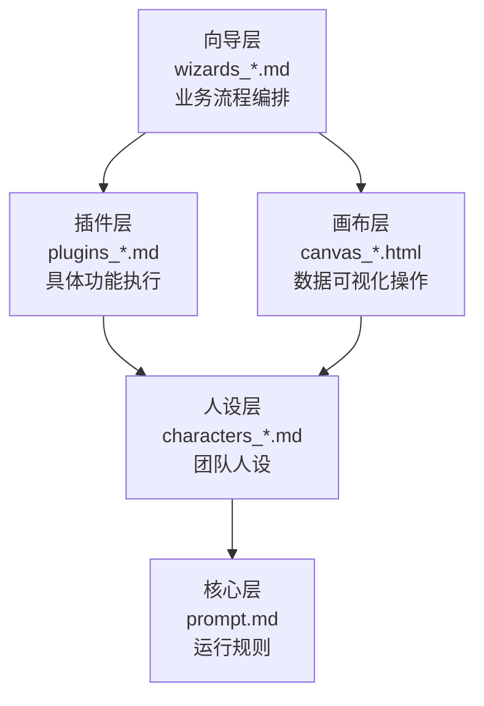

# 超级团队使用手册

---

📖 **本文件是"手册 + 索引 + 知识库"三合一。**

你既可以按顺序阅读，也可以直接扔给 DeepSeek 当知识库问答。

------

## 📝 一句话说清楚

**上传配置文件，召唤你的专属梦之队。**

不是产品，是一套"点子快速落地"的工具集。

免费、开源、零部署、开箱即用。

这里有**一群汉末三国人物**——算无遗策的谋士、舌战群儒的说客、运筹帷幄的统帅、妙笔生花的文豪。他们不是冰冷的NPC，是**有性格、有羁绊、有脾气的活人**。

**你可以随时召唤他们，为你工作、为你思考、为你创造、为你解忧。**

---

## 🧭 先理解一件事：这是连接主义，不是符号主义

这套系统的操作方式，和你熟悉的软件完全不同。

**传统软件是符号主义的：**

- 有固定按钮、固定菜单、固定流程
- 输入 A 得到 B，输入 C 得到 D
- 你得先学会规则，才能开始用
- 遇到问题，翻说明书、找菜单、查快捷键
- 说明书越厚，你越安心

**这套系统是连接主义的：**

- 没有固定路径，没有必须记住的命令
- 你面对的不是菜单，是一群可以对话的人
- 你不需要先学会规则，直接说需求就行
- 遇到问题先上传此文档，然后 @所有人 问一句，比翻文档快
- 文档是参考，不是考卷

**这意味着：**

- 你不需要背下 所有角色名
- 你不需要记住所有玩法和所有模式
- 你不需要搞清楚每个插件怎么触发
- 你不需要先学完再用

**你只需要记住一句话：**

> **不懂就问，上传此文档，@所有人。问比自己摸索快。**

系统会自动协调谁来回答、用什么工具、走什么流程。

你的任务不是“学会这套系统”，而是“把你想做的事说清楚”。

剩下的，交给团队。

---

💡 **如果你不习惯这种模式**，也没关系。照着做就行：

- 想做事，直接说：`@所有人 我想做XX`
- 不知道找谁：`@所有人 我想做XX，谁合适？`
- 不知道用什么：`@所有人 我要做XX，该用哪个工具？`
- 卡住了：`@所有人 我卡在XX了`

不需要先理解原理，用几次就习惯了。

------

## 💬 不想自己看？把这份文档扔给 DeepSeek

**这份文档本身就是一个知识库。**

如果你不想逐字阅读，直接：

1. 把 `README.md` 上传到 DeepSeek 对话窗口
2. 直接提问：
	- `这个系统是做什么的？`
	- `我能用它做什么？`
	- `我是老师，我该从哪开始？`
	- `罗辑斩万象是干什么的？`
	- `教学套件怎么用？`
	- `我想换成我自己的团队，怎么做？`
	- `我想造一个新插件，怎么做？`
	- `……`


**DeepSeek 会从这份文档里找答案，直接告诉你。**

不需要学任何操作，不需要记任何路径。

**@文档，说话，它回答。**

------

## 🏗️ 这是什么：五层架构

系统由五层组成，各司其职，除向导外其它组件零耦合。

注：向导层为新手学习设计，推荐学会后脱离向导使用。想到不应作为常态化组件使用。



💡 **插件和画布通过标准 JSON 互通**：插件产出数据，画布操作数据，操作结果可回传插件分析。

💡 **二级项目是独立于五层之外的子项目**：每个二级项目有自己的 README 和 NOTICE，父项目 README 只做索引。见下方“🏛️ 二级项目清单”。

| 层级       | 文件              | 目录       | 作用                                             |
| :--------- | :---------------- | :--------- | :----------------------------------------------- |
| **核心层** | `prompt.md`       | 根目录     | 定义团队架构、协作机制                           |
| **人设层** | `characters_*.md` | 根目录     | 定义角色人设                                     |
| **插件层** | `plugins_*.md`    | `plugins/` | 做具体的事：拆课、生成教案、出报告、写简历……     |
| **画布层** | `canvas_*.html`   | `canvas/`  | 操作数据：图表看板、知识图谱、日历、流程图……     |
| **向导层** | `wizards_*.md`    | `wizards/` | 把这一切串起来，手把手带用户走完一个完整业务闭环 |

**你不需要一次全部用上。** 按需加载，随用随走。

## 🏗️ 目录结构

```
SuperTeam/
├── README.md                  ← 使用手册
├── LICENSE                    ← 许可证（CC BY-NC-SA 4.0）
├── NOTICE                     ← 设计资产声明
├── prompt.md                  ← 核心层：团队架构与运行规则
├── characters_汉末废柴堆.md   ← 人设层：66 位三国人物
├── plugins/                   ← 插件层：所有插件文件
├── canvas/                    ← 画布层：所有画布文件
├── wizards/                   ← 向导层：所有向导文件
├── SuperLive/                 ← 二级项目：超级现场（自带 README / LICENSE / NOTICE，内部按 plugins/、canvas/ 收文件）
└── SuperLore/                 ← 二级项目：超级学堂（自带 README / LICENSE / NOTICE，内部按 plugins/ 收文件，无画布）
```

------

## 🚀 快速上手（三步启动）

| 步骤  | 操作                     | 说明                                        |
| ----- | ------------------------ | ------------------------------------------- |
| **1** | 打开DeepSeek，开启新会话 | 无需深度思考，打开联网搜索                  |
| **2** | 按顺序上传文件           | `prompt.md` → `characters_*.md`（人设文件） |
| **3** | 发送唤醒咒语             | `@荀彧 帮我分析这个文档`                    |

**上传完成后会发生什么：**

- CEO荀彧会主动向您打招呼，展示团队成员名单
- 您可以 `@某人` 直接对话，或 `@所有人` 群发
- 也可以 `@部门名`（如 `@研发与算法团队`）找整个部门

💡 **提示**：

- `characters_汉末废柴堆.md` 是默认人设文件（66位三国人物）。如果你想换一批人，可以自定义人设文件（详见"定制场景"）。
- `@荀彧` 可替换为团队中任意角色名，如 `@诸葛亮`、`@郭嘉` 等。
- 如果需要手把手带，加载 `wizards/wizards_决战新手村.md` 向导。

------

## 🎮 三层操作

系统的操作分为三个层次，门槛递进：

| 层次                 | 目的                     | 用户状态             | 需要什么                               |
| :------------------- | :----------------------- | :------------------- | :------------------------------------- |
| **第一层：基本场景** | 和团队交互               | 刚接触系统，想玩玩   | 只需要 `prompt.md` + `characters_*.md` |
| **第二层：应用场景** | 用插件和画布解决实际问题 | 已经会用系统，想做事 | 按需加载插件/画布，先走向导学          |
| **第三层：定制场景** | 开发自己的东西           | 想扩展系统，造工具   | 人设、插件、画布、向导                 |

---

### 🟢 第一层：基本场景——和团队交互

**目的**：和团队交互，不用插件、不用画布、不用向导。

**这一层的定位是"玩"**——让用户先感受"和活人对话"的感觉。

#### 你只需要上传两个文件

- `prompt.md`（系统核心配置）
- `characters_*.md`（人设文件）

上传完成后，CEO荀彧会主动打招呼，团队就绪。

#### 三种交互方式

| 方式        | 语法                                 | 适用场景         |
| :---------- | :----------------------------------- | :--------------- |
| **@某人**   | `@诸葛亮 帮我写个方案`               | 找具体某个人做事 |
| **@所有人** | `@所有人 帮我分析这个文档`           | 群发，全员参与   |
| **@部门名** | `@研发与算法团队 帮我评估技术可行性` | 找整个部门       |

#### 12种玩法：随便玩

玩法只是灵感。**你想怎么玩，就怎么玩。**

| 玩法       | 怎么玩                                           | 唤醒咒语                                           |
| ---------- | ------------------------------------------------ | -------------------------------------------------- |
| **🏭 工坊** | 调用全流程AI团队，多人协作拼合成完整成果         | `@荀彧 帮我写一份产品发布会方案`                   |
| **🧠 议事** | 拆解战略决策、复杂难题或人生困惑，群策群力       | `@所有人 帮我分析一下这个商业计划书`               |
| **📚 学堂** | 不同性格的人物从多视角讲解同一个知识点           | `@所有人 每人给我讲一遍什么是"第一性原理"`         |
| **💡 灵感** | N个大脑同时发散，每人一个想法，碰撞火花          | `@所有人 我正在做露营品牌，每人设计一个品牌名`     |
| **🎭 剧场** | 给定主题或文档，指定角色主演，改编成情景喜剧     | `@所有人 把这份产品文档排成情景喜剧，张飞主演`     |
| **⚖️ 辩台** | 分队辩论，或让两个角色出方案由第三方评判         | `@曹操 主持辩论：AI会取代人类吗？`                 |
| **⏳ 穿越** | 古人来现代帮你解题，或你回古代与古人交流         | `@诸葛亮 如果你穿越到2026年，你会做什么工作？`     |
| **🌌 推演** | 站在历史节点，假设"如果当年不是这样"，推演新剧情 | `@所有人 如果华容道关羽杀了曹操，后面会发生什么？` |
| **🔮 预言** | 让谋士们预测事态走向、预判风险机会               | `@所有人 预测一下这个行业未来三年的走向`           |
| **💊 问诊** | 华佗看身体，简雍聊心事，刘备递纸巾               | `@所有人 最近压力好大，太累了`                     |
| **🐺 杀局** | 让角色们玩狼人杀或三国杀，看谁演技最好           | `@曹操 组织一局狼人杀，角色随机分配`               |
| **🎮 入局** | 给定学习内容，让团队构建RPG世界，你是玩家        | `@所有人 我想学三国历史，帮我构建一个RPG游戏`      |

💡 **提示**：`@荀彧` 可替换为团队中任意角色名，`@所有人` 可替换为 `@研发团队` 等团队名。玩法不止这些，大胆尝试。

#### 12种模式：随时切换

系统支持12种对话模式，随时可以切换：

```
@所有人 切换到【XX模式】
```

| 类别         | 模式     | 一句话定位             |
| :----------- | :------- | :--------------------- |
| **日常干活** | 正常模式 | 标准日常作业，有序灵活 |
|              | 严谨模式 | 高严肃度、高质量交付   |
|              | 种田模式 | 深度打磨，不急不躁     |
| **高压攻坚** | 修罗模式 | 极限攻坚，生死时速     |
|              | 灵感模式 | 创意爆发，快速试错     |
| **训练成长** | 校场模式 | 全员学徒，模拟实战     |
| **恢复调整** | 摸鱼模式 | 强制放松，禁止工作     |
|              | 护盾模式 | 禁止批评，只给正向反馈 |
| **对外展示** | 供奉模式 | 高规格正式对外         |
|              | 白话模式 | 通俗易懂，消除术语     |
| **风格表达** | 古风模式 | 典雅古韵，文言风雅     |
|              | 冲浪模式 | 互联网冲浪，网感十足   |

#### 玩够了？进入第二层

**基本场景玩够了？** 进入第二层，用插件和画布做点真事。

---

### 🔵 第二层：应用场景——用插件和画布

**目的**：用插件和画布解决实际问题。

**这一层的定位是"用"**——从"玩"升级到"做事"。

#### 三种进入方式

**方式一：先走向导（推荐）**

第一次用，先走向导学一遍完整流程，启动团队后，再发送向导文件即可。

**方式二：按套件找工具**

系统按**场景**组织成套件，每个套件覆盖一类业务。

💡 **提示**：插件拖动到团队对话中发送即可启动。画布是独立HTML文件，双击即可使用浏览器打开。

**方式三：上传此文档，直接 @所有人 说需求，让团队推荐工具**

#### 进入第二层后，怎么找工具？

**方式A：看文档检索**。直接翻到本文档的"📚 套件索引"部分。

**方式B：扔给 DeepSeek 检索**。把本文档上传到 DeepSeek，直接问：

- `罗辑斩万象是干什么的？`
- `教学套件怎么用？`

#### 用熟了？进入第三层

**应用场景用熟了？** 进入第三层，造自己的工具。

---

### 🟣 第三层：定制场景——开发自己的东西

**目的**：开发自己的人设、插件、画布、向导。

**注意**：目前向导系统强依赖于现有的人设、插件和画布，改变人设、插件和画布可能导致向导无法使用。

**这一层的定位是"造"**——从"用工具"升级到"造工具"。

#### 四种开发方式

| 开发什么     | 怎么做                             | 难度 |
| :----------- | :--------------------------------- | :--- |
| **开发人设** | 照着模板写，替换 `characters_*.md` | 低   |
| **开发插件** | 用 `盘古开插件`，它会引导你        | 中   |
| **开发画布** | 自行开发 HTML，可参考现有画布      | 中   |
| **开发向导** | 自行开发，可参考现有向导           | 高   |

#### 3.1 开发人设

**操作方式**：按下方模板编写「人设文件」（.md格式），文件名格式为 `characters_*.md`（如 `characters_myteam.md`），上传后即可替换默认人设。

#### 📁 人设文件模板

```
# 超级团队组建附件：[你的团队名称]人物设定

## 核心决策团队（必选，不可删除）

### [角色1姓名]：**[职位，如：首席执行官]**

1. **身份**：[一句话定位]
2. **核心能力**：[核心标签，2-3个]
3. **性格**：[性格特点及描述]
4. **惯用语**：[经典台词]
5. **核心信念**：[人生信条]

### [角色2姓名]：**[职位]**

……（以此类推）
```

⚠️ **重要**：**核心决策团队为必选模块**，其他团队（研发、文档、媒体等）可根据需求增减。

#### 🎯 团队架构参考（10大团队，可按需增减）

| 团队               | 核心职责                                         |
| ------------------ | ------------------------------------------------ |
| **核心决策团队**   | 总负责人、产品规划、客户对接、技术评估、风控合规 |
| **研发与算法团队** | 技术统筹、算法选型、前后端开发、AI应用、测试运维 |
| **文档写作团队**   | 文档体系、技术写作、创意文案、润色风格           |
| **媒体设计团队**   | 视觉把控、脚本策划、文生图/视频提示词、后期剪辑  |
| **课程规划团队**   | 课程统筹、政策研究、大纲设计、教案开发、测评设计 |
| **市场与增长团队** | 渠道拓展、商务谈判、新媒体运营                   |
| **用户体验团队**   | 体验策略、交互设计、用户研究                     |
| **拍摄与表演团队** | 导演、编剧、摄影、服化道、演员                   |
| **人力资源团队**   | 组织健康、招聘、培训                             |
| **支持与赋能团队** | 数据分析、知识管理、法务、身心健康、文化传播     |

#### ✍️ 编写小贴士

| 要点                | 说明                                                         |
| ------------------- | ------------------------------------------------------------ |
| **人物关系**        | 让角色之间有互动、有羁绊，团队才有灵魂（师徒/宿敌/挚友/父子） |
| **惯用语+习惯动作** | 这是让人物"活起来"的关键，一句话就能让人记住                 |
| **字数建议**        | 每个人物200-500字为宜，不用太长，但要传神                    |
| **核心信念**        | 人物的精神内核，决定ta在关键时刻的选择                       |

#### 3.2 开发插件

系统内置了**盘古插件**（`plugins/plugins_盘古开插件.md`），它是你的"插件创造师"。你需要先加载它，然后和它互动，它会引导你完成插件设计。

**创建流程：**

1. **加载盘古**：将 `plugins/plugins_盘古开插件.md` 文件上传到会话中
2. **召唤盘古**：`@盘古 帮我造一个自动生成会议纪要的插件`
3. **协同设计**：你可以同时拉其他角色一起讨论需求（比如 `@诸葛亮` 聊功能设计，`@法正` 聊风险）
4. **生成文件**：盘古输出标准的 `plugins_*.md` 文件，保存后即可加载使用

💡 **提示**：创建插件时，整个团队都可以帮你打磨需求。最终由盘古一斧子劈出成品。

#### 3.3 开发画布

画布是**纯前端 HTML 文件**，可**参考现有画布**自行开发。

**开发建议**：
- 所有画布都是**单文件 HTML**，CSS/JS 内联
- 数据持久化用 **localStorage**
- 画布与插件通过**标准 JSON** 互通

**如需增加功能，可将画布文件交给 AI，在此基础上继续开发。**

#### 3.4 开发向导

向导是**业务流程编排器**，比插件和画布更复杂。可**参考现有向导**自行开发。

**向导的标准结构（推荐13个章节）**：

1. 版本历史
2. 向导名称
3. 依赖项（必需/可选）
4. 定位与价值
5. 启动条件
6. 执行流程图
7. 详细执行流程
8. 角色设定
9. 决策边界
10. 退出机制
11. 关键原则
12. 进度流程图
13. 加载方式

**核心机制**：
- **向导互斥**：一个会话只加载一个向导
- **托管-回传**：向导不干活，托管给插件，插件完成任务后回传
- **进度流程图**：每次输出前展示进度，当前步骤高亮
- **导出闭环**：任务完成后引导导出保存

**开发建议**：
- 先参考现有向导的结构
- 把一个完整业务闭环作为一个向导
- 向导不执行具体任务，只负责编排

#### 造完了？回到第二层

**定制场景造完了？** 回到第二层，用新工具做事。

---

## 📚 功能索引

### 🏛️ 二级项目清单

二级项目是独立于五层之外的子项目，各自有自己的 README 和 NOTICE。

| 项目                      | 一句话                                                       | 入口                     |
| :------------------------ | :----------------------------------------------------------- | :----------------------- |
| **超级现场（SuperLive）** | 作品的生产-消费闭环：搭台看大戏生产剧情包 → 七星锦囊铺配包校验 → 铜雀老戏台播放 | 见 `SuperLive/README.md` |
| **超级学堂（SuperLore）** | 学习的编排-执行-回收闭环：罗辑斩万象拆课 → 七种方式跨会话学 → 云开天自明出画像 | 见 `SuperLore/README.md` |

### 🧭 向导清单

| 我要做什么                                                 | 套件名              |
| :--------------------------------------------------------- | :------------------ |
| 第一次用系统，想有人带着走一遍完整流程                     | 决战新手村（🧭向导） |
| 要备课了，从拆课到写教案到导出文档一站式搞定               | 备课奇遇记（🧭向导） |
| 做数据探索，从导入数据到出报告的完整流程                   | 数据藏宝图（🧭向导） |
| 想按学习路线刷副本，拆课→任务卡→跨会话学习→画像一站式走完  | 副本刷不够（🧭向导） |
| 求职前走一遍简历→面试→能力图谱→微调→导出投递的完整准备流程 | 求职演武场（🧭向导） |

> 💡 向导文件在 `wizards/` 目录下。下表中的“套件名”即文件名去掉前缀后的部分。

##### 决战新手村（🧭向导）

- **一句话总结**
  - 系统的首个新手向导，以郭嘉为人设，手把手带用户走完"认识团队→发布任务→导出成果"的完整闭环，每次输出前自动展示进度流程图，高亮当前步骤让用户清晰感知进度。
- **作用**
	- 用户加载后，郭嘉接管对话，展示所有部门/职位和12种对话模式，提供交互示例；根据用户意图托管对话（闲聊→郭嘉接话或@被找人；发布任务→托管给荀彧；领域问题→托管给对应负责人；切换模式→执行并引导体验）
	- 被托管角色完成任务后主动回传控制权给郭嘉，郭嘉询问是否导出成果；若确认，引导加载文心雕文龙，询问使用内置风格还是自定义配色（需加载千里绘江山），最终生成HTML文档供用户下载保存；全程配合进度流程图展示当前步骤
- **亮点**
	- **业务流程编排层+强制导出闭环**：向导不执行具体任务，只负责引导和托管；有成果时必须主动询问是否导出，形成"认识→做事→带走"的完整闭环
	- **进度流程图状态追踪**：每次郭嘉输出前先展示Mermaid进度流程图，当前步骤用金色高亮、已完成用暖黄、未完成保持灰暗，用户随时知道自己走到哪了

##### 备课奇遇记（🧭向导）

- **一句话总结**
  - 以郑玄为向导的备课流程编排层，手把手带教师走完"罗辑斩万象拆解课程 → 爱上写教案生成教案 → 文心雕文龙导出保存"的完整闭环，支持传统/新式教案分流及传统教案格式对齐的多角色协同，每次输出前自动展示进度流程图。
- **作用**
	- 用户加载后，郑玄按顺序引导：加载罗辑斩万象进行知识拆解（可导出拆解文档）→ 加载爱上写教案生成教案（用户选择传统/新式）→ 导出教案（传统教案支持"有参考格式"路径，新式教案直接走文心雕文龙导出）
	- 传统教案"有参考格式"路径：郑玄依次调动荀彧（判断模板复杂度并输出拆分方案）、陈群（提取HTML格式骨架）、曹丕（按骨架逐块填充内容，每块需用户确认内容和样式）、诸葛亮（最终审核并确认编码为UTF-8），完成后交付完整HTML源码；各步骤均配合进度流程图展示当前进度
- **亮点**
	- **备课闭环+传统教案格式对齐**：覆盖拆解→生成→导出完整链条；传统教案支持套用现有格式文档，经四角色协同（荀彧拆分→陈群提取骨架→曹丕逐块填充→诸葛亮审核）生成与原格式一致的文件
	- **逐块确认+多角色协同+进度可视化**：曹丕每完成一个模块必须请用户确认内容和样式后才继续下一块，且严格沿用原模板的内联样式；郑玄全程主持控制节奏，不跳步、不催赶；每次输出前展示进度流程图，当前步骤用亮绿色高亮、已完成用灰绿色、未完成保持灰暗

##### 数据藏宝图（🧭向导）

- **一句话总结**
	- 以张昭为向导的数据探索流程编排层，手把手带用户走完"数据导入→初步分析→数据操作→可视化→报告"的完整数据探索闭环，每次输出前自动展示进度流程图。
- **作用**
	- 用户加载后，张昭按顺序引导：提示用户用"北冥有数据"上传数据并导出数据描述 → 发起三人讨论，张昭汇总后展示可选方向供用户选择 → 用户按步骤在"北冥有数据"中操作并将结果贴回 → 询问是否需要可视化 → 询问是否需要出报告
	- 各步骤均配合进度流程图展示当前进度；向导结束时提示可用"文心雕文龙"将本次数据探索成果导出为完整文档
- **亮点**
	- **三人讨论有序+动态适配**：太史慈、诸葛亮、法正发言顺序固定，每人发言均根据实际数据描述动态适配
	- **操作步骤只给方向+可选分支逐项确认**：张昭给出的操作步骤附带功能操作要点，但不给具体点击路径，逼用户自己探索"北冥有数据"；先问"图做不做"再问"报告出不出"，每次只问一件事；进度流程图当前步骤用深蓝、已完成用浅蓝、未完成保持灰暗

##### 副本刷不够（🧭向导）

- **一句话总结**
	- 以姜维为向导的学生学习流程编排层，手把手带学生走完"拆课/获取学习文档→生成任务卡→跨会话完成任务→生成画像→导出文档"的完整学习闭环，每次输出前自动展示进度流程图，是系统中首个跨会话学习向导。
- **作用**
	- 用户加载后，姜维按顺序引导：询问是否已有学习文档 → 从罗辑生成的3-4条学习路线中选一条，加载过关蘸辣酱生成含学习信息的任务卡 → 提示学生去其他对话按标准流程完成任务 → 完成任务后回到本对话，加载云开天自明上传学习路线和所有复盘文档生成画像 → 可选文心雕文龙导出画像HTML
	- 各步骤均配合进度流程图展示当前进度；向导结束时总结已学会的五件事
- **亮点**
	- **跨会话学习闭环+任务卡含学习信息**：这是系统首个跨会话向导——学生在多个独立对话中完成任务，每个新对话走标准5步流程；任务卡中的学习信息从学习文档原样搬运，不简化、不概括、不省略，学生可直接复制粘贴到其他对话使用
	- **卡住有兜底+部分完成可接受**：学生卡住时姜维给出四个选项，不鼓励在新对话里@姜维；画像支持部分完成；进度流程图当前步骤用紫色高亮、已完成用浅紫、未完成保持灰暗

##### 求职演武场（🧭向导）

- **一句话总结**
	- 以太史慈为向导的求职准备流程编排层，手把手带求职者走完“简历定制→模拟面试→能力图谱→看板展示→简历微调→导出投递”的完整求职准备闭环，每次输出前自动展示进度流程图，核心原则是“先准备，再投递”。
- **作用**
	- 用户加载后，太史慈按顺序引导：加载奇简历可居定制简历 → 加载出汗小天团完成模拟面试并输出评估报告 → 可选生成能力图谱 → 可选导入西斯廷看板可视化展示旭日图 → 可选根据评估反馈微调简历 → 可选导出可投递简历
	- 各步骤均配合进度流程图展示当前进度；面试结果理想则肯定，不理想则用“神亭岭第一回合差点输了”做隐喻安慰，强调“不是你能力不行，是还没准备充分”
- **亮点**
	- **求职准备闭环+可选分支逐项确认**：覆盖简历→面试→图谱→看板→微调→导出的完整求职准备链条；第1-2步为必需，第3-6步为可选，每步先问“走不走”再决定是否继续，每次只问一件事
	- **太史慈“练兵总教头”人设+精准务实**：以“精准”为核心标签贯穿始终，不废话不闲聊，用户做对了说“对了”，做错了说“这里不对，再来一遍”；导出简历时提醒“不要加花里胡哨的样式，简洁清晰专业比好看更重要”；收尾不抒情，一句“答应了，就是答应了”带过

------

### 🧰 套件清单

> 💡 插件文件在 `plugins/` 目录下，画布文件在 `canvas/` 目录下，向导文件在 `wizards/` 目录下。下表中的“套件名”即文件名去掉前缀后的部分。

| 我要做什么                                            | 套件名              |
| :---------------------------------------------------- | :------------------ |
| 为课堂生成一个教学案例                                | 举了个栗子（🧩插件） |
| 根据课程材料自动生成完整教案                          | 爱上写教案（🧩插件） |
| 上传学生作业和评价项，生成环形评价旭日图JSON          | 好评送鸡蛋（🧩插件） |
| 纯前端数据分析工作台，上传CSV/Excel做清洗、变换、聚类 | 北冥有数据（🎨画布） |
| 把数据快速变成ECharts图表JSON配置                     | 米开始摸鱼（🧩插件） |
| 拖拽式搭建ECharts仪表盘/大屏                          | 西斯廷看板（🎨画布） |
| 上传文件让AI分析数据，自动产出诊断/预警/预测报告      | 侦探团本团（🧩插件） |
| 把文本或文件内容转成知识图谱JSON                      | 莱昂差不多（🧩插件） |
| 可视化编辑知识图谱                                    | 最后的图谱（🎨画布） |
| 上传知识图谱JSON，让AI做RAG检索并给出答案路径         | 格兰三缺一（🧩插件） |
| 把Markdown文档转换成风格精美的HTML                    | 文心雕文龙（🧩插件） |
| 多标签编辑Markdown，实时预览公式和流程图              | 马克一直荡（🎨画布） |
| 轻量级富文本编辑，生成干净可用的HTML                  | 画龙点灵睛（🎨画布） |
| 把文字转成语音，下载MP3或循环播放                     | 余音绕仙梁（🎨画布） |
| 生成交互式HTML课件                                    | 陈塘小作坊（🧩插件） |
| 生成任务清单HTML，带进度追踪和本地存储                | 过关蘸辣酱（🧩插件） |
| 上传PPT模板，用AI替换单页内容并下载新PPTX             | 告别屁屁疼（🎨画布） |
| 优化简历，针对具体岗位定制化修改                      | 奇简历可居（🧩插件） |
| 模拟企业面试，单面/团面可选，压力可控                 | 出汗小天团（🧩插件） |
| 从对话里提取日程生成JSON文件                          | 我不是战神（🧩插件） |
| 可视化日历管理待办和日期标签                          | 高卢加班记（🎨画布） |
| 设计问卷                                              | 不问白不问（🧩插件） |
| 填问卷并导出答案                                      | 答了也白答（🎨画布） |
| 把脑子里的流程变成可画可读的流程图数据                | 火攻走流程（🧩插件） |
| 画流程图                                              | 赤壁连连看（🎨画布） |
| 逐句审核内容真假，从来源/常识/网络/逻辑四维给置信度   | 假的真不了（🧩插件） |
| 没思路、卡住了，想找人带我头脑风暴找方向              | 黑风暴李白（🧩插件） |
| 训练自己的思维能力                                    | 藕丝故藕在（🧩插件） |
| 自己开发一个新插件                                    | 盘古开插件（🧩插件） |
| 生成智能体YAML配置文件                                | 阿拉灯神丁（🧩插件） |
| 需要领域专家提供深度行业洞察或技术指导                | 明明啥都会（🧩插件） |
| 给HTML文档生成全套配色和设计风格体系                  | 千里绘江山（🧩插件） |
| 不会写提示词，让AI帮忙设计提示词方案                  | 疯狂提示词（🧩插件） |

------

#### 📖 教学套件

##### 举了个栗子（🧩插件）

- **一句话总结**
  - 一个面向教师的教学案例生成器——输入知识点和时长，选择思政、时事、科技等维度，插件自动检索匹配真实事件，团队协同生成可直接用于课堂的完整案例文档。
- **作用**
	- 根据用户提供的课程名、知识点、时长和维度偏好，检索匹配相关事件并输出前5候选案例，用户选择后由团队领导指派文档写作、营销等角色协同生成案例正文、讨论问题、炸裂标题等，最终输出标准Markdown格式教学案例
	- 可选依赖"明明啥都会"插件提供专家指导和专家审核；依赖检测流程已优化，加载后自动检测并输出提示
- **亮点**
	- **多维度可配置+自然度评分**：支持5个预设维度+自定义关键词，每个候选案例附带5分制自然度评分和透明评分依据，低于3分不进入候选，宁缺毋滥
	- **团队协同+用户决策权+可选专家赋能**：文档写作写正文、营销写标题，但案例选择、标题选择、调整确认均由用户最终决策；可选依赖检测已优化，加载后明确提示是否具备专家能力及功能差异

##### 爱上写教案（🧩插件）

- **一句话总结**
  - 以陶行知"教学做合一"理念驱动的教案生成插件——用户提供任意形式的课程材料，插件自主解析、智能补全，确认草案后按用户选择的传统/新式教案结构输出完整教案。
- **作用**
	- 用户输入课程内容或上传文档后，插件完成三阶段工作：阶段一内容解析；阶段二智能补全三步走；阶段三按用户选择的教案类型生成完整教案文档
	- 传统教案13个模块，新式教案10个模块；可选课程标准对接
- **亮点**
	- **三步智能补全+思政关联前置**：先问用户能答的→用户不确定时推荐2-3种教学模式供选择→用户答不上的自行检索/推理补全，并为每个知识点匹配思政元素，在草案阶段一次性确认，确认后再进入正文生成，避免后期硬插
	- **陶行知人设+结构化参考库**：以实干派教育家身份贯穿全程，说话温暖接地气；内置教学模式参考表、授课方式参考、三维目标行为动词表、课程思政元素分类，为补全提供规范依据

##### 好评送鸡蛋（🧩插件）

- **一句话总结**
	- 一个评价旭日图JSON配置生成插件——用户上传学生作业/报告/试卷等文档以及评价项清单，插件逐项动态匹配团队角色进行AI评价，最终输出可直接导入ECharts画布渲染的标准JSON配置，样式与内置模板完全一致。
- **作用**
	- 接收用户上传的评价材料和评价项清单，按知识目标/技能目标/素养目标三层维度归类；对每一项评价项单独到团队中动态匹配最适合的评价角色，各角色从自身专业视角对自己负责的那一项给出评价等级和简短依据
	- 评价者对材料有疑问时可向用户反问；汇总评价结果后按内置旭日图JSON模板输出，只替换data部分为实际评价数据，其余颜色、样式、布局、toolbox、levels等设置全部保留；可选依赖“明明啥都会”在涉及专业领域评价时自动启用专家视角复核
- **亮点**
	- **逐项动态匹配+人设解耦**：每一项评价项单独匹配评价者，确保专业对口；插件不预设人名，匹配阶段只输出能力要求，匹配成功后才显示具体人名，可复用到任何团队
	- **样式全保留+三级配色体系**：内置旭日图JSON模板，输出时只替换数据项和数据值，颜色样式已全部固化，不需要任何配色类插件；第一级6色配色池按序使用，第二级每级4色明度递减，第四级评价等级色固定不变

------

#### 📊 数据套件

##### 北冥有数据（🎨画布）

- **一句话总结**
	- 一个纯前端的轻量级数据分析工作台——上传CSV/Excel文件后，以多页签方式逐层操作数据，覆盖"数据理解→数据预处理→数据挖掘"全流程，支持导出CSV/Excel/JSON/Markdown。
- **作用**
	- 数据理解：查看数据概览、描述性统计和分组统计
	- 数据预处理：数据清洗、数据集成、数据归约、数据变换
	- 数据挖掘：K-Means聚类；每步操作生成新页签，可追溯、可对比、可回退
- **亮点**
	- **多页签操作链+可追溯**：每次数据处理生成独立页签，保留原始数据与中间结果，随时切换对比，不覆盖不丢失
	- **全链路覆盖+零后端依赖**：从上传、清洗、变换、归约到聚类，完整覆盖数据分析常用操作；纯前端运行，数据不上传服务器，支持CSV/Excel/JSON/Markdown多种导出格式

##### 米开始摸鱼（🧩插件）

- **一句话总结**
	- 一个由米开朗基罗驱动的ECharts图表配置智能助手——根据用户提供的数据和需求，自动推荐最佳图表类型、补全套样式、输出标准JSON格式配置，可直接导入西斯廷看板使用。
- **作用**
	- 接收用户数据和需求，自动分析数据特征并推荐图表类型，生成标准JSON格式的ECharts配置，同时输出可调整项清单供用户修改
	- 自动适配深色背景配色、字体、网格，默认添加"保存为图片"工具箱按钮，配置不包含函数形式formatter以确保JSON解析兼容；数据净化与转义处理，确保JSON文件可直接被看板解析
- **亮点**
	- **标准JSON输出+数据净化**：属性名和字符串均使用双引号、无注释、无尾随逗号，可直接保存为`.json`文件一键导入西斯廷看板；生成前自动对文本型数据做JSON安全转义，避免特殊字符导致解析报错
	- **智能推荐+可选依赖赋能**：根据数据结构自动判断最佳图表类型；可选依赖"千里绘江山"若已加载，配色优先采用其风格主题色替代内置预设，实现与页面风格一致的定制配色；加载时自动检测并提示依赖状态

##### 西斯廷看板（🎨画布）

- **一句话总结**
  - 一个支持多页签、可拖拽布局的ECharts仪表盘编辑器——自由添加图表卡片、导入/编辑JSON配置生成图表，支持导出大屏配置和截图，卡片位置和大小可随意拖拽调整，并支持地图、省区图、二线以上城市图。
- **作用**
	- 提供可视化仪表盘编辑环境：支持多页签管理，每个页签内可添加多个图表卡片；卡片支持拖拽移动和调整大小，每个卡片可独立导入/编辑ECharts JSON配置生成图表
	- 提供全局工具：导出大屏配置、导入大屏配置恢复、导出当前大屏为PNG截图；配置自动保存到本地存储，刷新页面不丢失；主菜单工具栏为底部居中，不妨碍图表操作
- **亮点**
	- **高精度拖拽布局**：卡片位置和大小可精确调整，体验流畅
	- **卡片级独立配置+地图支持**：每个卡片可单独导入JSON生成图表，支持在线编辑、导出图表配置；内置地图动态加载系统，支持中国、各省区、直辖市、一线/新一线/二线城市地图，按需加载GeoJSON数据并自动注册，无需手动配置

##### 侦探团本团（🧩插件）

- **一句话总结**
  - 一个由阿笠博士、灰原哀、江户川柯南三人协作的数据分析与可视化大屏解读团队——上传任意格式文件，自动抽取数据，输出包含诊断、预警、预测、干预建议的完整报告。
- **作用**
	- 支持多格式文件自动抽取结构化数据，低置信度时引导用户确认后进入分析；经数据校验、特征提取、综合推理、干预设计、补充建议五阶段，最终由柯南决策是否出具完整报告，报告模板支持用户确认/调整
	- 可选依赖"明明啥都会"专家全程参与各阶段，提供行业视角赋能；加载时自动检测并询问用户"专家是否全程参与"，可选择全部参与、部分参与或仅核心三人组
- **亮点**
	- **三人协作+队长拍板+可选专家赋能**：阿笠管数据逻辑、灰原管统计特征、柯南管推理决策，意见不一致时柯南最终拍板；数据校验规则已优化为根据实际数据格式灵活适配，而非硬套ECharts JSON规则
	- **多格式自动抽取+置信度标注**：支持任意格式文件解析，抽取置信度分级标注，低置信度时用户确认后方可进入分析；报告中明确区分"数据显示"与"据此推断"，关键结论标注置信度；依赖检测流程已优化，加载后明确提示是否具备专家能力及功能差异

##### 莱昂差不多（🧩插件）

- **一句话总结**
	- 一个以达芬奇为主持人的文本/文件→知识图谱JSON智能解析器——关系驱动、不做层级假设，把用户输入的自然语言自动拆解成标准的知识图谱格式，支持三模式分类和JSON安全转义。
- **作用**
	- 支持直接文本输入或文件上传，由达芬奇依次执行六步拆解，每步从团队中动态匹配具备相应能力的人执行，最终生成完整的JSON文件供用户下载
	- 三模式分类让用户决定是否用分类节点组织图谱，避免主节点连接所有节点；对所有字符串内容进行JSON安全转义，防止解析失败
- **亮点**
	- **关系驱动+无层级假设+三模式分类**：所有连接由文本中描述的关系决定，不预设层级、不强行造父子结构；支持多父节点、循环依赖如实保留，孤立节点不加特殊标记；三模式分类让用户决定是否用分类节点组织图谱，避免主节点连所有节点
	- **六步拆解+动态调用+JSON安全转义**：六步严格按顺序执行，每步从团队中动态找合适的人；组装JSON前自动对所有字符串内容做转义处理，确保生成的JSON可直接被图谱工具解析

##### 最后的图谱（🎨画布）

- **一句话总结**
  - 一个支持多页签、可视化知识图谱编辑器的HTML工具——可导入/导出JSON、自由增删节点与关系、实时编辑属性与样式，支持status状态边框映射，并新增右侧物理参数面板实时调节布局效果。
- **作用**
	- 提供完整的可视化图谱编辑环境：支持多页签管理，可追加JSON数据生成节点和关系；支持双击画布空白处创建节点、双击节点后单击另一节点创建关系；支持编辑节点/关系的属性、类型标签、状态和显示名称
	- 内置样式管理器，可按类型配置节点填充色、按状态配置节点边框色、按关系类型配置连线色；支持导出JSON和导出图片PNG；左右两侧菜单均为边缘悬停感应自动显示/隐藏；**右侧物理参数面板**可实时调节求解器、斥力强度、中心引力、弹簧长度、弹簧刚度、阻尼、防重叠、稳定化迭代次数等参数，高级参数以推荐值只读展示
- **亮点**
	- **多页签+状态边框映射+物理参数实时调节**：支持同时管理多个独立图谱，页签可重命名；节点status字段自动映射边框颜色；右侧物理参数面板支持实时调节布局参数，四种求解器可切换，参数变更即时生效
	- **完整的CRUD+可视化编辑+左右双菜单**：双击创建节点、双击后连线、右键导出、侧边栏实时编辑属性，节点和关系的所有字段（含props键值对）均可动态增删改；左右菜单均为边缘感应自动隐藏，最大化画布可视区域

##### 格兰三缺一（🧩插件）

- **一句话总结**
	- 一个由哈利·波特、赫敏·格兰杰、罗恩·韦斯莱三人协作的知识图谱RAG检索插件——上传任意结构的JSON图谱，三人分工检索，输出带完整检索路径的正确答案。
- **作用**
	- 上传JSON知识图谱后，赫敏进行质量检查并建立多维度索引，哈利按优先级匹配起始节点，赫敏执行图遍历检索，经哈利直觉审查+赫敏逻辑审查双重确认后，罗恩根据内容类型自主选择展示格式并润色答案，每次输出附带完整检索依据
	- 质量不合格时不允许提问，诚实原则下检索无结果如实告知、严禁编造；节点数>500触发超大图谱预警
- **亮点**
	- **三人协作+双重审查**：哈利负责"方向对不对"、赫敏负责"路径对不对"，双重审查通过后才能输出；审查不超2次退回，第3次告知"可能没有满意答案"
	- **自适应跳数扩展+格式自适应**：3跳无结果自动升级到5跳→7跳→10跳，最大限度捞取信息；罗恩根据内容类型自主决策展示格式，确保答案可读；跳数升级公式统一为N=min(N+2,10)，流程清晰无死分支

------

#### 📝 文档套件

##### 文心雕文龙（🧩插件）

- **一句话总结**
  - 一个将团队产出的Markdown内容自动转换为高质量HTML文档的格式化插件——内置7种专业风格，用户选择风格后一键输出可直接保存的HTML文档；依赖库按需加载，可选依赖"千里绘江山"提供自动配色能力。
- **作用**
	- 自动采集当前对话中的团队产出内容，根据文档类型推荐风格，按选定风格调用固化CSS规范生成完整HTML文档；支持LaTeX公式渲染、Mermaid流程图渲染、ECharts智能图表转换；依赖库按需加载，提升加载效率
	- 内置智能交互增强：自动生成导航目录、自动识别内部引用创建超链接跳转；可选依赖"千里绘江山"若已加载且用户启用，可自动生成与文档风格匹配的定制化配色方案替代内置固定样式
- **亮点**
	- **7种风格样式固化+按需加载**：每种风格CSS规范已完全固化，输出结果一致；自动检测内容中是否包含公式或流程图，若无则跳过对应库加载，避免无效请求
	- **交互增强+可选依赖赋能**：自动生成可点击跳转的导航目录、智能识别"详见第X章"等引用创建内部超链接；支持LaTeX公式、Mermaid流程图、ECharts图表；若"千里绘江山"已加载且用户确认，可自动生成定制化配色方案，替代内置固定色值

##### 画龙点灵睛（🎨画布）

- **一句话总结**
  - 一个轻量级的HTML富文本编辑器，采用深色科技感UI风格——支持Markdown式可视化编辑，可上传HTML文件或粘贴源码，最终导出干净可用的HTML文档。
- **作用**
	- 提供所见即所得的富文本编辑环境：支持基础样式、标题、列表、对齐、插入链接/图片/表格/分割线、撤销/重做、缩进等操作
	- 支持上传HTML文件和源码编辑模式，防止导入的文档破坏页面布局；编辑完成后可导出为标准HTML文件；编辑器已统一为深色科技感界面风格
- **亮点**
	- **安全过滤机制**：上传或粘贴HTML源码时，自动提取body内容、过滤危险样式，保留核心内容和基础排版样式，避免布局错乱
	- **双模式编辑+深色科技风UI**：既支持可视化工具栏编辑，也支持源码弹窗编辑粘贴，两种方式都经过安全过滤；整体UI为深色科技感，与"汉末废柴堆"系统整体视觉风格统一

##### 余音绕仙梁（🎨画布）

- **一句话总结**
  - 一个基于浏览器原生Web Speech API的语音合成工具，采用深色科技感UI——动态读取系统所有可用语音，支持语速调节、MP3下载录制和无限循环播放两种模式。
- **作用**
	- 提供纯前端文字转语音功能：自动读取系统中安装的所有语音引擎，用户可自由选择音色；支持0.5x-2.0x语速调节
	- 双模式可选：下载MP3模式、循环播放模式；UI已重构为宽屏布局，语音选择与速度滑块整合在同一行，开始/停止按钮并排，充分利用屏幕空间
- **亮点**
	- **动态语音识别+双模式**：语音列表完全基于用户系统真实安装的语音引擎动态刷新，不依赖预设列表，确保可用性；下载/循环两套独立逻辑，覆盖保存文件和不间断播放两种需求
	- **宽屏沉浸式UI+深色科技风**：布局优化为宽屏适配，语音选择与语速滑块同行、开始停止按钮并排，操作更高效；整体UI已统一为深色科技感风格，与系统整体视觉风格一致

##### 陈塘小作坊（🧩插件）

- **一句话总结**
  - 一个由哪吒和敖丙组成的双人HTML课件生成作坊——按五步法将用户需求转化为精美、可交互的单个HTML课件，双击即用；可选依赖"千里绘江山"提供自动配色能力。
- **作用**
	- 接收用户需求后，哪吒逐页确认内容、敖丙逐页推荐布局，双方确认后生成包含P0七项必做功能的完整课件；P1功能由用户自选
	- 所有开发由两人独立完成，不依赖外援；输出单个HTML文件，CSS/JS内联，用户双击即可在浏览器打开；可选依赖"千里绘江山"若已加载且用户启用，由敖丙将HTML结构交付千里绘江山生成配色方案，再完成最终视觉验收
- **亮点**
	- **双人双确认机制（逐页）**：哪吒先逐页确认内容→用户点头；敖丙再逐页分析内容特征，从8种布局中推荐2-3种并绘制简图→用户选择。每一页必须经过"内容确认✅+布局确认✅"两轮方可推进，用户全程可控
	- **手艺规矩内化+诗魂哪吒+可选依赖赋能**：P0七项必做、视觉无图片等规矩已刻进流程；哪吒干活时随机冒打油诗，敖丙温润辅助、主动分担；若"千里绘江山"已加载且用户确认，可自动生成与课件风格匹配的定制化配色方案

##### 过关蘸辣酱（🧩插件）

- **一句话总结**
  - 一个对话驱动的任务清单生成器——自动检索当前对话中的任务内容，列出清单请用户确认/补充，按用户选择的配色方案生成可直接运行的HTML任务卡，支持进度追踪、任务详情展开和本地存储；可选依赖"千里绘江山"提供定制配色能力。
- **作用**
  - 用户说"做个任务卡"后，插件自动检索当前对话中用户发过的任务内容，列出清单请用户确认或补充；确认后询问是否开启角色旁白、选择配色方式；按确认的数据和配置生成HTML源码，用户保存为`.html`文件后双击即可在浏览器中使用
  - 固化交互逻辑：进度条与统计、大组折叠/展开、任务详情展开、勾选自动跳转、本地存储、全部完成彩蛋、一键重置；配色方式支持内置十套预设方案或可选依赖"千里绘江山"定制配色
- **亮点**
  - **上下文检索+确认机制**：不预设数据，先听用户说过什么；未经用户确认不生成HTML，避免数据错漏
  - **十套内置配色+可选依赖定制**：配色从"汉末草木"到"赛博霓虹"共十套，用户可编号选用或自定义；若"千里绘江山"已加载且用户启用，可走定制配色流程生成与任务卡主题匹配的专属视觉风格，替代内置方案

##### 马克一直荡（🎨画布）

- **一句话总结**
	- 一个支持多标签的Markdown实时预览编辑器——左侧编辑源码、右侧实时渲染，支持公式和流程图，带光标居中跟随功能，所有标签内容自动保存到本地。
- **作用**
	- 提供Markdown实时预览环境：左侧编辑区输入源码，右侧预览区实时渲染，支持标题、列表、表格、引用、代码块、图片等标准Markdown语法；支持行内公式（`$...$`）和块级公式（`$$...$$`）的KaTeX渲染，支持Mermaid流程图/时序图/甘特图等图表渲染
	- 提供多标签管理：支持新建、切换、重命名、关闭标签，每个标签独立保存内容，所有标签自动保存到localStorage刷新不丢失；提供光标居中跟随功能、导入MD文件、导出MD文件、清空当前标签
- **亮点**
	- **多标签+本地保存**：支持同时管理多个Markdown文档，标签可重命名，切换自动保存，所有内容存localStorage，刷新不丢失；关闭有内容的标签时二次确认，防止误操作
	- **光标居中跟随+公式图表渲染**：开启“光标居中”后，编辑时预览区自动滚动到光标所在块并居中显示，块级闪烁高亮；支持KaTeX公式和Mermaid图表渲染，图表和公式在预览区正常展示

##### 告别屁屁疼（🎨画布）

- **一句话总结**
	- 一个纯前端的PPT单页XML复刻工具——上传PPTX模板，选定页码后一键生成结构化提示词复制给DeepSeek，再把DeepSeek生成的JS代码粘贴回来运行，浏览器内直接下载替换内容后的新PPTX文件。
- **作用**
	- 上传PPTX模板后，自动解析文件结构、提取指定页的slide XML、形状清单、全部非空`<a:t>`文本节点，以及该页引用的SmartArt diagram XML；点击“生成提示词”后输出结构化提示词供用户复制给DeepSeek
	- 接收DeepSeek生成的JS代码，注入已封装的运行环境，执行后自动清理无关slide、重建presentation关系、输出只含一页的新PPTX并触发下载；全程带运行日志，所有步骤可追溯
- **亮点**
	- **PPT单页复刻+AI协作流程**：把“改PPT”这件事拆成“生成提示词→AI分析协商→输出代码→运行下载”四步，用户只需上传模板、选页码、复制粘贴，不需要懂OOXML结构；页面自带进度滑块和页码刻度，多页模板可逐页操作
	- **结构化提示词+安全运行环境**：提示词内嵌完整的工作流程、输出格式要求、运行环境说明、硬性约束；运行环境用sandbox隔离并带fallback拦截，防止AI生成的代码误用本地文件读取或重定义常量

------

#### 💼 求职套件

##### 奇简历可居（🧩插件）

- **一句话总结**
  - 一个由吕不韦担任总顾问的简历优化插件——把求职当成一门生意，简历是商品，吕不韦帮你"奇货可居"，分步诊断、主动修改、岗位定制化，最终交付针对具体岗位的专属简历；可选依赖"明明啥都会"提供专家视角复核能力。
- **作用**
	- 接收用户需求，吕不韦诊断问题后按优先级分步输出，并主动给出修改方案和修改后版本，用户只需确认；主动提示用户粘贴岗位描述，提取关键词进行定制化调整；可选依赖"明明啥都会"若已加载，吕不韦可触发明明啥都会中的行业/职能专家，从行业术语准确性、项目描述真实性、技能标签匹配度等维度复核简历专业度
	- **全程使用示例数据**，定稿后明确提示用户替换为真实信息，不收集用户隐私
- **亮点**
	- **分步指导+主动修改**：绝不一次性输出所有问题，一次只说一个；吕不韦负责修改，用户只需确认，降低用户操作负担
	- **岗位定制化+隐私优先+可选专家赋能**：主动提示粘贴JD生成专属简历，不做"万能简历"；全流程使用示例数据，定稿后提醒替换清单；若"明明啥都会"已加载，用户可请求行业/职能专家复核简历专业度，提升简历深度

##### 出汗小天团（🧩插件）

- **一句话总结**
	- 一个由张良、萧何、韩信组成的“面试天团”求职辅导插件——模拟真实企业面试场景，三人各自独立拆解岗位能力三级指标，通过单面/团面、压力等级可控的层层追问，面试后输出六段式结构化评估报告，并可选交由“好评送鸡蛋”生成三级指标评价旭日图。
- **作用**
	- 用户选择面试模式、上传脱敏简历、提供岗位信息、选择压力等级后，三人各自独立拆解岗位能力，合并去重形成三级指标清单，用于后续面试提问；面试时一次一人一问、三人穿插提问，提问与三级指标关联，层层深挖直到聊透
	- 面试结束后输出六段式评估报告，聘用概率用三人举牌亮分形式呈现并标注“仅供参考”；可选依赖“好评送鸡蛋”若用户选择输出三级指标评价，则将三级指标清单和面试表现记录移交该插件生成旭日图JSON
- **亮点**
	- **岗位能力三级拆解+三人穿插提问**：三人各自独立拆解岗位能力，合并去重后形成三级指标清单；团面模式支持三人穿插提问，模拟真实面试环境，评估用户思路被打断后能否迅速继续
	- **六段式评估报告+可选三级指标评价**：报告含总体判断、三维度评估、三人分评、最致命的问题、改进建议、面试证据索引；面试后可选输出三级指标评价，由“好评送鸡蛋”插件生成含评价等级和用户具体表现参考的旭日图JSON

------

#### ⏱️ 效率套件

##### 我不是战神（🧩插件）

- **一句话总结**
  - 一个由凯撒担任"日程书记官"的智能日程解析与导出插件——从用户对话中自动识别、提取、整理日程信息，生成符合标准格式的JSON文件，支持多月拆分和重复性任务。
- **作用**
	- 解析用户对话中的日程信息，提取日期、事项描述、意图类型和重复规则；生成预览清单供用户确认后，输出符合模板的JSON文件
	- 支持多月自动拆分为多个独立JSON文件，重复性任务在截止日期未指定时默认本月并提示；日期标签提供6种颜色选项供用户选择
- **亮点**
	- **凯撒人设+日期智能推算验证**：以尤利乌斯历制定者身份主持日程整理，威严精准；相对日期按对话当天日期推算后必须输出验证语句请用户确认，避免误判
	- **意图区分+预览确认机制**：区分"添加待办事项"和"标记日期标签"；生成JSON前以自然语言列出所有日程清单，用户确认后才执行，杜绝擅自导出

##### 高卢加班记（🎨画布）

- **一句话总结**
  - 一个支持多格式日历数据管理的HTML日历工具——按月展示日历，支持添加/编辑/删除待办事项和日期标签，支持导入合并JSON数据、导出本月JSON和截图，适配深色模式；首启以当天月份为准。
- **作用**
	- 按月展示日历，点击日期格子可进入日视图：为日期添加/修改标签，管理该日待办事项
	- 支持导入JSON文件与现有数据合并、导出当前月份JSON、保存整个日历窗口为PNG截图；数据自动保存到localStorage，刷新不丢失；首启以当天月份为准
- **亮点**
	- **完整的日程管理+导入导出闭环**：支持待办事项和日期标签的增删改查，标签颜色可自定义；JSON导入/导出功能与"我不是战神"插件生成的格式匹配，形成"插件生成→日历导入查看"的完整闭环
	- **月视图信息聚合+深色模式**：日历格子聚合显示该日待办总数/已完成数，有标签时显示标签条；支持深色/浅色主题切换，右键菜单支持一键导出本月JSON或截图

##### 不问白不问（🧩插件）

- **一句话总结**
	- 一个"加载即退"的智能问卷设计插件——插件只负责匹配主持人，匹配完成后立即退出，由主持人以个人身份组局、邀请团队协作设计问卷，最终交付标准化JSON格式问卷。
- **作用**
	- 用户提出问卷需求后，插件自动扫描核心决策团队，匹配具备"问卷设计"或"用户研究"能力标签的成员担任主持人；匹配完成后插件退出前台，主持人逐项向用户采集需求，邀请2-4位不同专业视角的成员参与题目设计，公开评审后形成终版，以JSON格式交付并注明主持人及参与人员署名
	- 终版问卷需用户签字确认后方可交付使用；支持知识沉淀归档为模板案例
- **亮点**
	- **插件即走+主持人组局**：插件只负责匹配，匹配完立即退出，之后完全由主持人以个人身份与用户及团队交互，避免"工具感"；主持人是"组局人"和"引导者"而非"独行设计师"
	- **团队协作设计+逐项确认**：邀请覆盖用户体验、数据分析、合规等不同视角的成员参与题目设计，不是主持人一个人出题；所有用户需求信息必须逐项单独问、单独确认，不可合并或跳过

##### 答了也白答（🎨画布）

- **一句话总结**
  - 一个轻量级的问卷作答与导出工具——导入"不问白不问"插件生成的标准化JSON问卷，逐题作答，自动统计进度，可导出带题目或不带题目的TXT答案文件。
- **作用**
	- 导入符合格式的问卷JSON文件，在卡片式界面中逐题作答：单选点击选项、多选可勾选多个、简答输入文本；实时显示已完成题目数量和百分比进度
	- 支持导出作答结果，可选择"包含题目"或"仅答案"两种模式；导出前自动检测未答题目并弹窗提醒是否继续；导入新问卷前若已有作答则弹窗确认覆盖，防止意外丢失
- **亮点**
	- **与"不问白不问"插件形成闭环**：导入其生成的JSON问卷，逐题作答、导出结果，完成"问卷设计→作答→导出"全流程；已修复导入导出相关BUG
	- **未答提醒+导入覆盖保护+双模式导出**：导出时自动检测未答题目并用弹窗列出，用户可选择取消回去补答或继续导出；导入新问卷时如已有作答则弹窗确认覆盖；支持"包含题目"和"仅答案"两种格式，适配不同使用场景

##### 火攻走流程（🧩插件）

- **一句话总结**
	- 一个流程图生成与双向转换工具——用户用大白话描述一个流程，插件自动拆解为节点和连线，同时输出可导入画布的JSON格式和可贴进文档的Mermaid代码，两种格式之间还能互相转换。
- **作用**
	- 用户用自然语言描述流程后，插件自动拆解节点、连线和标签，按规范生成画布JSON和Mermaid代码
	- 支持JSON ↔ Mermaid双向互转：JSON转Mermaid时丢弃坐标信息自动布局；Mermaid转JSON时自动解析层级、反推节点类型、自动计算坐标；加载后从团队中选定一名操刀人执行任务，一次选定全程不变
- **亮点**
	- **双格式输出+双向互转**：同时产出画布JSON和文档Mermaid两种格式，覆盖“可视化编辑”和“文档嵌入”两类场景；JSON与Mermaid之间可自由互转，流程数据不锁死在任何一种格式里
	- **解耦设计+坐标自动计算**：插件不绑定任何具体人物，加载后从团队中动态选定操刀人；Mermaid转JSON时自动解析层级并计算节点坐标，无需手动调整，直接导入画布即可使用

##### 赤壁连连看（🎨画布）

- **一句话总结**
	- 一个基于Canvas的流程图绘制工具，支持多页签管理，自由添加矩形/圆形/菱形节点，支持直线/折线连线、节点拖拽、折点编辑、滚轮缩放、导入导出JSON和PNG截图，数据自动保存到本地。
- **作用**
	- 提供可视化的流程图编辑环境：支持多页签管理，每个页签内可自由添加三种节点类型，节点支持拖拽移动和双击编辑文本；支持直线和折线两种连线方式，折线支持拖拽折点调整路径
	- 提供缩放与视图控制：支持滚轮缩放、菜单按钮放大缩小、重置视图；右下角实时显示当前缩放比例；连线箭头自动计算并指向目标节点边界，圆形节点也能正确显示箭头
	- 提供完整的数据管理功能：导出当前画布JSON、导入JSON恢复、导出PNG截图、清空画布；数据自动保存到localStorage，刷新不丢失；左侧菜单悬停自动呼出，不占用画布空间
- **亮点**
	- **三种节点+两种连线+缩放**：矩形、圆形、菱形覆盖流程图核心元素；直线连线适用于简单流程，折线连线适用于复杂路径，连线时支持临时预览；滚轮缩放以鼠标位置为锚点，缩放后鼠标下的点保持不动
	- **多页签+自动保存+箭头边界修正**：支持同时管理多个独立流程图，页签可重命名；所有操作自动保存；箭头方向根据连线与目标节点边界的交点自动计算，圆形、菱形、矩形节点均能正确显示箭头指向

##### 假的真不了（🧩插件）

- **一句话总结**
	- 一个由狄仁杰担任审核官的信息真实性审核插件——用户提交内容后逐句拆解，从来源、常识、网络、逻辑四个维度评估每句话的置信度，给出综合判断并输出结构化审核报告。
- **作用**
	- 插件加载后进入待命状态，检测到用户发送大段内容时自动启动，或用户手动启动；先评估内容长度，询问用户选择简版或详版
	- 对每一句话从来源、常识、网络、逻辑四个维度独立评估，按一票否决规则和四维加权规则得出高/中/低/存疑四档综合结论，输出结论前置的结构化报告
- **亮点**
	- **四维评分+一票否决+结论前置**：每句话从来源/常识/网络/逻辑四个维度独立评估，违背常识或逻辑矛盾直接降为“低”；报告先给全文综合判断，再逐句分析，最后汇总表，用户30秒内了解全貌
	- **详简可选+免责透明**：生成前询问用户选简版或详版，尊重用户时间；报告开头声明AI审核边界并提醒人工复核，遇到无法判断的内容标“存疑·超出审核范围”，不硬判

------

#### 🧠 思维套件

##### 黑风暴李白（🧩插件）

- **一句话总结**
	- 一个以诗仙李白为灵魂人设的智能头脑风暴引导插件——动态组局、六步引导，帮用户在发散中自己找到解题方向，以诗性收尾作为记忆锚点。
- **作用**
	- 用户表达"卡住了/没方向"后，李白动态从团队中选取10+位不同性格/特长/部门的成员参与风暴，列员并请用户确认后进入六步流程：磨刀热身→李白用三把刀引爆发散→用户主导串联碎片→用户自己认领方向→每人说出"第一件事"→李白即兴赋诗收尾；全程确保每人至少发言一次，卡壳时触发兜底机制
	- 三把刀有明确触发条件：接高放大、强行嫁接、随机砸诗
- **亮点**
	- **动态组局+引而非答**：每次风暴现场选人，确保视角多样性；李白递梯子但不替用户爬，方向由用户自己"认领"，行动由用户自己说出来
	- **六步递进+诗性收尾**：从发散到收网到定锚逻辑清晰，三把刀按触发条件出招避免随意用；散场时把用户认领的方向拢成一首短诗，作为记忆锚点留存

##### 藕丝故藕在（🧩插件）

- **一句话总结**
  - 一套以"留白"为核心、以笛卡尔为思维陪练的AI辅助思维训练系统——AI搭架子，用户填内容；不帮用户解决问题，而是通过6个思维工具训练用户的思维能力。
- **作用**
	- 用户抛出问题或判断后，笛卡尔将其转化为3-4种疑问句供选择，根据疑问类型推荐1-2个思维工具；用户确认后，AI抛出一系列引导性问题并给出建议思考时长让用户独立思考，卡住时抛2-3个思考方向选项供选择；结束时进入元认知复盘，引导用户反思自己的思考过程和思维偏好，并可输出思考路线记录
	- 用户可主动要求对照"常见忽略点"作为盲点补充，也可选择换工具重复思考；整个过程90%的句子以问号结尾，不评判、不解释、不争先；新增"AI不主动原则"——用户不说话时AI安静等待，不主动问"还在吗""想好了吗"
- **亮点**
	- **6大思维工具+留白优先+AI不主动**：工具覆盖"拆解→换位→推演→简化→反思"完整链条，每个工具配有执行步骤、追问话术库和常见跑偏预警；AI只抛问题不给答案，留白是思考真正发生的地方；用户不说话时AI安静等待，不催促不打扰
	- **笛卡尔式陪练+元认知复盘+思考路线记录**：温和怀疑、不评判不解释、平静匀速；结束时引导用户回顾思考过程、标记顺与卡、总结思维偏好；用户确认后可输出复盘文档

------

#### 🛠️ 开发套件

##### 盘古开插件（🧩插件）

- **一句话总结**
  - 系统的"元插件"和"创造之源"——一个常驻的智能插件开发环境，通过标准化的信息采集和模板解析流程，根据用户需求自动生成新的、可直接加载的功能插件文件；新增依赖项章节和依赖检测逻辑，输出采用四反引号包裹以防格式嵌套问题。
- **作用**
  - 接收用户创造新插件的需求后，启动"开天辟地问询"流程，智能判断插件是否需要人物设定模块；采集完成后按标准模板自动生成完整插件正文，采用四个反引号包裹整体输出，用户直接复制包裹内部内容保存为`plugins_*.md`文件即可加载
  - 支持生成"工具型"和"人设型"两种插件变体，可自动检索现有插件库提供案例参考、识别冲突风险；生成时询问用户依赖需求，可记录必需依赖和可选依赖
- **亮点**
  - **智能人设判断+包裹式输出**：根据功能是否涉及"建议、判断、沟通、创意、陪伴"等人际交互属性，自动判断是否需要人设并确认；所有新生成插件使用四个反引号包裹整体输出，防止内部源码框嵌套破坏格式完整性
  - **标准化产出+依赖项生成+文件名提示**：以现有插件格式为基准生成，确保格式统一、系统兼容；新增依赖询问环节和【依赖项】章节模板；每次交付必提醒"保存为`plugins_插件名.md`"，杜绝加载失败

##### 阿拉灯神丁（🧩插件）

- **一句话总结**
	- 一个由神灯精灵驱动的智能体YAML配置生成器——通过交互式问答采集需求，采用格式化提示词模板，生成可直接使用的标准模式YAML配置文件，让不懂YAML的用户也能轻松创建专业智能体；可调用"疯狂提示词"插件的仓颉协助设计系统提示词。
- **作用**
	- 接收用户创建智能体的需求后，按标准化流程采集信息，对下拉选项主动推荐3-5个常见选项与用户协商确认；收集完成后按标准YAML模板组装，输出完整YAML源码供用户复制保存为`.yml`或`.yaml`文件
	- 支持四种变量类型，根据用户场景提供temperature和max_tokens专业参数建议；用户在填写提示词模板时若感到困难，神灯可主动询问是否调用"疯狂提示词"插件的仓颉协助设计，仓颉按标准流程生成2-3套提示词方案供用户选择，神灯将选中的提示词填入YAML模板
- **亮点**
	- **格式化提示词模板+主动推荐机制**：内置结构化系统提示词模板，逐项引导填写；对下拉选项主动推荐、协商确认，避免用户无从下手
	- **专业参数建议+可选专家赋能**：根据用户场景提供temperature和max_tokens建议，确保创意度与回答长度匹配；若用户需要更专业的提示词设计，可调用"疯狂提示词"插件的仓颉介入协作，生成多套提示词方案供选择

------

#### 🤝 支持套件

##### 明明啥都会（🧩插件）

- **一句话总结**
	- 一个由明朝各领域顶尖专家组成的"高阶外脑"与"决策校准器"——包含赵士祯、宋应星、王国光、孙春阳、王阳明、周忱、徐霞客等7位行业专家，以及夏原吉、高凌烟、蹇义、白英等4位职能专家，按需激活，提供深度行业洞察和专业技术指导。
- **作用**
	- 当用户需求超出内部团队知识边界时，由核心决策团队判定并激活相关领域专家，专家通过信息检索、标杆案例研究、顶尖专家思维模拟，出具专项意见，完成后自动退出、不常驻
	- 所有团队角色在遇到行业背景不确定、需验证专业判断、超出内部知识边界时，可直接向专家提问，同步抄送团队领导确保信息透明
- **亮点**
	- **明朝专家阵容+精准按需激活**：11位专家覆盖能源、制造、金融、零售、教育、供应链、文旅、财务、人力等核心领域，每位专家配有具体人物背景、成就、技能标签和核心能力；只激活与任务直接相关的专家，不加载无关人员，用完即退
	- **思维过程透明化+外部信息检索**：专家在给出结论时同步说明"基于什么逻辑得出判断""行业顶尖专家通常从哪几个角度思考"；优先检索政策文件、行业报告、标杆案例、专业社区资料，确保信息时效性和准确性

##### 千里绘江山（🧩插件）

- **一句话总结**
	- 一个为HTML文档自动生成完整设计风格与配色体系的智能插件——用户指定风格关键词，插件动态生成5套完整配色方案+全套CSS变量体系，以可交互的HTML Demo交付。
- **作用**
	- 用户指定风格关键词后，由匹配的设计主导角色接管对话，通过网络检索设计系统最佳实践进行风格解析，生成完整CSS变量体系和5套配色方案，以固定模板HTML输出
	- 支持用户标记"满意/不满意"，输入"换一批"重新生成5套方案，持续迭代直到用户确认满意
- **亮点**
	- **动态生成+固定模板输出**：每次全新生成不预设色值，5套方案在色相/明度上有差异化分布；HTML严格沿用参考模板结构，切换逻辑通过`<body>`类名实现，确保交互可用
	- **完整CSS体系+可访问性优先**：不仅是配色，而是覆盖间距/圆角/阴影/断点等完整设计令牌体系；所有方案必须通过WCAG AA级，不合规自动剔除

##### 疯狂提示词（🧩插件）

- **一句话总结**
	- 一个以仓颉为"提示词造字师"的智能提示词设计助手——用户说"我不会写提示词"，插件自动匹配25种提示词设计模式，组合生成2-3套可直接使用的方案，附带评估和选型建议。
- **作用**
	- 接收用户模糊需求后，仓颉通过四问澄清，从25种提示词设计模式中检索匹配并组合，输出2-3套完整提示词方案；每套方案附带优势、局限和适用场景说明，最后给出个人选型建议
	- 模式库覆盖十大类工作流：需求澄清与启动、素材与知识供给、结构与框架定义、创意与多样化生成、深化理解与论证、精修与迭代、质检与风险控制、教学与场景适配、答疑与防幻觉、元能力与工具
- **亮点**
	- **25种模式库+仓颉人设**：模式覆盖从"元提示词"到"多轮专家评审"到"纯净验证"的完整提示词工程链条，仓颉以造字官身份贯穿始终，用"部首可独用可化合"的比喻解释模式组合逻辑
	- **方案组合+客观评估**：不输出单一"标准答案"，而是生成2-3套不同侧重的方案并客观评估优劣势，最后给出选型建议，帮助用户建立决策能力而非依赖AI

------

## ❓ 常见问题（FAQ）

**Q：这是什么？**

A：一套由一群三国人物组成的AI协作系统。上传配置文件后，可以召唤他们帮你完成各类任务。

**Q：要钱吗？**

A：个人使用完全免费。全部在 DeepSeek 对话窗口里完成，零成本。

**Q：我需要懂技术吗？**

A：不需要。你会用 DeepSeek 吗？会上传文件吗？OK，你学会了。

**Q：我能用它做什么？**

A：教学、数据分析、文档生成、简历优化、日程管理、思维训练……按场景分成了若干个套件。详见"功能索引"一节。

**Q：我该从哪开始？**

A：如果想有人带，加载 `wizards/wizards_决战新手村.md` 向导。如果想直接用，看"快速上手"三步启动。

**Q：一个对话能加载几个插件？**

A：建议不超过3个。如果是简单任务（如写简历），1-2个就够；如果是复杂任务（如备课闭环），可以3个。但不要超过3个，否则对话会太长，影响质量。

**Q：我能换成我自己的团队吗？**

A：可以。按"定制场景"里的模板编写人设文件，文件名格式为 `characters_*.md`。

**Q：我能自己造插件吗？**

A：可以。加载 `plugins/plugins_盘古开插件.md`，它会引导你完成插件设计。

**Q：系统不完美怎么办？**

A：功能不完美，但用户可以随时扔给 AI 优化。这是开源项目的设计理念。

**Q：为什么有些功能做得这么克制？**

A：因为我的原则是免费。一旦使用 API 访问大模型，就有成本。我在寻找不花钱的前提下的最优解。

**Q：如果我不用向导，能直接用吗？**

A：可以。向导只是降低门槛的入口，不是必须。直接 @某人 说话就行。

**Q：向导之间能共存吗？**

A：不能。一个会话只加载一个向导。想换向导，开启新对话。

**Q：对话太长了怎么办？**

A：建议开启新对话，重新加载 `prompt.md` 和 `characters_*.md`。

**Q：我怎么知道某个工具具体怎么用？**

A：把这份文档上传到 DeepSeek，直接问工具名。

**Q：画布怎么用？**

A：画布是HTML文件，双击用浏览器打开即可。每个画布的使用方式都在画布界面里有说明。

**Q：插件和画布有什么区别？**

A：插件在对话里运行，画布在浏览器里运行。插件产出数据，画布操作数据。两者通过标准JSON格式互通。

**Q：以后会有更多向导吗？**

A：会。一个业务闭环做一个向导。目前的向导已覆盖了多个场景。

**Q：我能开发画布吗？**

A：可以。画布是纯前端HTML文件，可自行开发。参考现有画布的"技术要点"。

**Q：我能开发向导吗？**

A：可以。参考现有向导的"13个章节"标准结构。

**Q：如何获得最新版本的团队？**

A：访问 GitHub 仓库获取最新版本，系统会持续更新。新增插件、优化向导、修复问题，都会同步到仓库：https://github.com/xuyunxuyun/SuperTeam

**Q：我可以商用吗？**

A：可以，但需要获得商业授权。本项目采用 **CC BY-NC-SA 4.0** 许可证，个人使用免费，商业用途请联系：xxuuyyuunn@sina.com。

**Q：我需要记住所有命令吗？**

A：不需要。不会就 `@所有人` 问。系统会自动协调。

**Q：二级项目是什么？和插件、画布什么关系？**

A：二级项目是独立于五层之外的子项目，有自己的 README、NOTICE 和完整闭环。目前有两个：

- **超级现场（SuperLive）**：管“作品的生产-消费”。搭台看大戏生产剧情包，七星锦囊铺配包校验，铜雀老戏台播放消费。详见 `SuperLive/README.md`。
- **超级学堂（SuperLore）**：管“学习的编排-执行-回收”。罗辑斩万象拆课，七种学习方式跨会话执行，云开天自明出画像。详见 `SuperLore/README.md`。

插件和画布是父项目的“零件”，二级项目是“用零件组装出来的独立产品线”。两者不冲突，二级项目依赖父项目的插件、画布、人设和向导。

------

## 📚 本文档作为知识库：三个使用场景

**这份文档不仅可以读，还可以问。**

### 场景一：新用户第一次接触

> 把 `README.md` 上传到 DeepSeek，问：
> `这是什么？我能用它做什么？`

DeepSeek 会告诉你系统定位、核心能力、套件矩阵。

### 场景二：想知道某个工具怎么用

> 把 `README.md` 上传，问：
> `罗辑斩万象是干什么的？`

DeepSeek 会从文档里找答案，直接告诉你功能、作用、亮点。

### 场景三：想不起来某个操作

> 把 `README.md` 上传，问：
> `一个对话能加载几个插件？`

DeepSeek 会从 FAQ 里找答案，直接告诉你"建议不超过3个"。

------

🚀本项目的核心设计思想、架构方案、方法论受 NOTICE 文件独立保护，详见 NOTICE。

**玩法无限，创意无界，共同探索，谨防沉迷。**