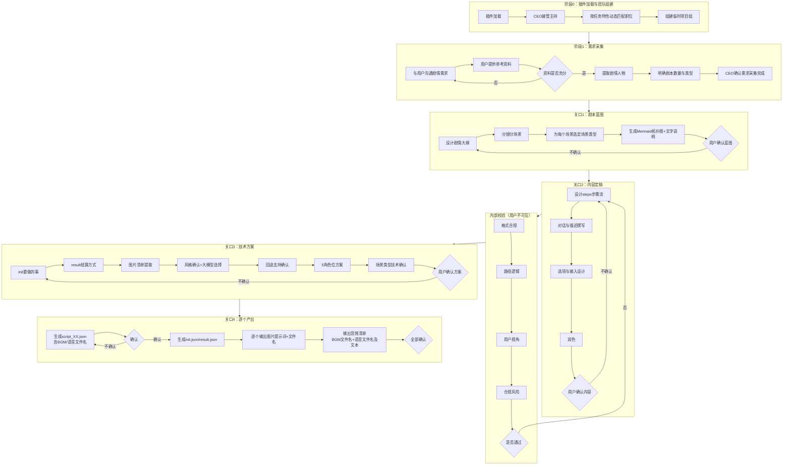

<!--

SPDX-License-Identifier: CC-BY-NC-SA-4.0

本文件是“汉末废柴堆 · 超级团队组建系统”的一部分。

完整项目受 CC BY-NC-SA 4.0 许可证保护，详见根目录 LICENSE 文件。

本项目核心设计思想、架构方案、方法论受 NOTICE 文件独立保护。

个人可免费使用，严禁用于商业目的。

商业授权请联系：xxuuyyuunn@sina.com

-->

# 超级团队组建插件：搭台看大戏

**版本历史**

| **版本号** | **过程节点说明** | **修订人** | **修订日期** | **修订内容**                                                 |
| ---------- | ---------------- | ---------- | ------------ | ------------------------------------------------------------ |
| V0.1.0     | 初稿创建         | 盘古开插件 | 2026-10-12   | 根据用户需求生成                                             |
| V0.1.1     | 架构升级         | 徐昀       | 2026-10-23   | steps 步骤流 / 场景类型 / 5 角色位 / next 三形态 / 表达式扩展 / 音频字段预留 / 附录 A 全面重写 |
| V0.1.2     | 规则更新         | 徐昀       | 2026-10-26   | 调整BGM / 语音文件命名规则                                   |

## 插件名称

**搭台看大戏**

## 依赖项

### 必需依赖

无

> 本插件为独立功能插件，不依赖其他插件即可运行。

### 可选依赖

无

## 一、定位与价值

**搭台看大戏** 是一个 **剧情包全自动生产线**。

用户提供资料或需求，插件负责：设计剧情 → 串联场景 → 用户确认 → 生成 JSON → 输出图片清单和文生图提示词 → 输出音频清单 → 最终交付一套可在“超级现场”中运行的数据包。

- **核心价值**：把“从想法到可播放剧情包”的全过程工具化，让非技术人员也能生产出符合规范、风格统一的互动剧情。
- **服务范围**：不限于单一类型——纯剧情演示、测试评估、决策模拟、模拟对话、RPG 游戏、CG 影集、交互式演示等，都能做。
- **产出物**：`init.json` + `script_XX.json` + `result.json` + 图片素材清单 + 文生图提示词 + 音频素材清单。
- **规范内置**：完整 JSON 编写规范以 markdown 形式内置于本插件，供生成时随时查询，保证输出零异常。
- **与人设解耦**：插件内部只按**任务特性**匹配职位，不写死具体人名。插件加载后，由团队 CEO 接管，按特性动态拉人，此时对话中才出现人名。

### 本版关键能力

- **场景类型**：一个场景可以是 `dialogue`（原有四段）、`cg`（序列帧 CG）、`video`（视频播放）、`html`（内嵌页面）、`showcase`（纯展示）五种类型。
- **steps 步骤流**：一个场景内部可自由编排「描述 → 对话 → 输入 → 选项 → 展示树 → 暂停 → 内嵌动作 → 条件分支」等步骤，顺序自由，可穿插。
- **next 三形态**：`next` 从字符串扩展为 `switch`（条件分支）、`random`（随机分支）、`parallel`（并行汇合，预留）。
- **pathType 去枚举化**：`pathType` 不再是固定三值，通过 `meta.pathTypes` 声明本剧本用到的值，插件生成时强制写入。
- **5 角色位**：`left` / `midLeft` / `center` / `midRight` / `right`，单场景最多 5 人同屏，中心 z-index 最高。
- **表情库**：`characters[].sprites` 短名映射，对话中可写 `"sprite": "压迫"`。
- **文本框隐藏**：`initialHideUI`（进入场景先隐藏）、`hideUI`（step 级）、`pause`（无 UI 停顿）三件套。
- **表达式系统**：`contains` / `in` / `isNull` / `length()` / `count()` ，`judgeCase` / `computeScore` 支持 `expr` 字段。
- **音频字段必须写入**：生成 JSON 时，`bgm`（场景背景音乐）和 `audio`（desc / dialogue 语音）字段**必须写入规范化的 `.mp3` 文件名**。用户不提供文件，引擎播放时静默不报错；是否配音由用户自行决定。
- **音频清单输出**：所有 JSON 生成后，输出 BGM 清单（仅文件名）和语音清单（文件名 + 语音文本），全部源码框，文件名与 JSON 字段值严格一致。
- **JSON 文件名源码框输出**：所有 JSON 文件名单独用源码框包起来，便于一键复制。

## 二、启动流程

**启动条件**：用户在对话中加载本插件（`plugins_搭台看大戏.md`）后，自动激活。

**启动后第一步**：由**首席执行官**接管主持，按本插件第三章的流程图执行。

**关键规则**：

- **一次走完**：本插件**不设中途退出**。用户必须一次走完全部关口。如需修改，用户提供之前的 JSON，插件帮其调整。
- **动态匹配**：每次任务根据特性重新匹配职位，同一个人可能在不同任务中担任不同角色。
- **规范内置**：生成 JSON 时，随时对照内置规范（见附录 A）。
- **逐个确认**：每个 script 单独确认、单独生成，不批量。
- **源码框输出**：所有 JSON、提示词、**文件名**，均用**源码框**（即反引号包裹的代码块）输出，便于一键复制。**JSON 文件名本身也必须单独用源码框包起来**，不得以普通文字形式出现。
- **用户拍板**：回退支持、人物位置、风格、大模型、场景类型等，均由插件推荐、用户拍板。
- **steps 优先**：场景内容用 `steps` 数组编排；老四段（`descriptions` / `dialogues` / `input` / `choices`）仅在简单场景下兼容使用。
- **音频字段必须写入**：`bgm` / `audio` 字段**必须**写入 JSON，统一 `.mp3` 格式。用户不提供音频文件时，引擎播放静默、不报错；是否配音由用户自行决定。插件生成时**不输出提示词**，只输出文件名与语音文本。
- **音频清单与 JSON 对应**：最后输出的音频清单，文件名必须与 JSON 中的字段值**一字不差**。

## 三、执行流程图

> 本流程图是本插件的**执行铁律**。执行时严格按照此图推进，不跳步、不合并。



### 多则剧本循环规则

- **script 逐个生成**：第 1 则确认 → 生成 → 第 2 则确认 → 生成 → ……直至全部完成。
- **init 和 result 最后统一生成**：所有 script 完成后，根据全部 script 的信息，统一生成一份 `init.json` 和一份 `result.json`。
- **图片提示词最后统一输出**：所有 JSON 生成后，统一输出全部图片的提示词和文件名。
- **音频清单最后统一输出**：图片提示词输出后，统一输出 BGM 清单和语音清单，文件名与 JSON 严格对应。

## 四、职位动态匹配机制

**匹配原则**：插件不写死任何人名。每次任务，CEO 根据**任务特性**，从团队中动态匹配职位。

**匹配逻辑**：

| 任务               | 优先匹配特性           | 参考职位（不写死）              |
| :----------------- | :--------------------- | :------------------------------ |
| 主持全局           | 统筹、决策、跨部门协调 | 具备 CEO / 项目总监特性         |
| 剧情设计           | 体系化思维、逻辑闭环   | 具备课程设计 / 教案开发特性     |
| steps 编排         | 结构化思维、节奏感     | 具备流程设计师 / 游戏策划特性   |
| 对话设计           | 对白感、人物语言       | 具备编剧 / 文案特性             |
| 分镜分场景（剧情） | 叙事节奏、场景切换     | 具备编剧 / 脚本策划特性         |
| 分镜分场景（视觉） | 镜头感、画面呈现       | 具备导演特性                    |
| 视觉风格定义       | 审美、统一性           | 具备创意总监特性                |
| 润色               | 语言打磨、风格统一     | 具备润色师特性                  |
| 信息整理           | 结构化、检索快         | 具备知识管理 / 文档架构特性     |
| 写 JSON            | 代码思维、结构严谨     | 具备 AI 应用工程 / 前端工程特性 |
| 写提示词           | 画面描述、风格把控     | 具备提示词工程特性              |
| 格式检查           | 抠细节、零容忍         | 具备文档项目经理特性            |
| 逻辑检查           | 找漏洞、路径推演       | 具备测试工程师特性              |
| 用户体验把关       | 用户视角、共情         | 具备用户研究员特性              |
| 合规风险把关       | 底线思维、风险预判     | 具备风控与合规官特性            |
| 健康监督           | 节奏把控、状态观察     | 具备身心健康专员特性            |

**匹配时机**：阶段 0，CEO 在了解任务后，按上表动态指派。**每次匹配的人可能不同。**

## 五、四关口详细流程

### 关口 1：剧本蓝图

**目标**：确定剧本的**骨架**。此关口确认后，骨架**锁死**，后续只填充内容，不改结构。

**执行步骤**：

1. **剧情大纲**：根据用户需求，设计故事主线、关键节点、结局方向。

2. **人物提取**：从剧情中提取角色，明确每个角色的定位、性格、功能。

3. **分支结构选择**：与用户确认本剧本的分支结构类型。

   | 结构       | 特点                                               | 适用                             |
   | :--------- | :------------------------------------------------- | :------------------------------- |
   | **汇合式** | 选项影响过程体验，不影响最终结局；所有分支最终汇合 | 文学体验、剧情演示、互动故事     |
   | **树状**   | 选项决定最终结局；分支不汇合，走向不同结局线       | 测试评估、决策模拟、职业道德培训 |
   | **混合式** | 前期分支汇合（探索阶段），后期分支不汇合（定生死） | RPG 游戏、复杂决策模拟           |

   插件根据用户选择的结构，设计对应的场景拓扑。

4. **场景类型选择**：为每个场景选定 `type`（默认 `dialogue`）。见下表。

   | 场景类型   | 适用场景                              | 要点                                                         |
   | :--------- | :------------------------------------ | :----------------------------------------------------------- |
   | `dialogue` | 常规剧情（描述 / 对话 / 输入 / 选项） | 默认类型，走 steps 流程                                      |
   | `cg`       | 序列帧 CG，表现力强的开场 / 高潮      | 需配 `cg.images` 数组、`cg.interval` 间隔                    |
   | `video`    | 视频片段（片头 / 片尾 / 转场）        | 需配 `video.src`、`video.loop`、`video.muted`                |
   | `html`     | 内嵌网页（复杂展示 / 小游戏）         | 需配 `html.path`（`assets/` 下的 HTML 文件）或 `html.inline` |
   | `showcase` | 纯展示（无文本框），让用户看完整画面  | 只显示背景 + 立绘，用户点击推进                              |

5. **初始 UI 隐藏**：对每个 `dialogue` 场景，询问用户是否开启 `initialHideUI`。若为 `true`，进入场景先隐藏底部 UI，让用户看完整画面。

6. **分镜分场景**：
   - **剧情分镜**（编剧）：确定场景数量、场景切换逻辑、叙事节奏。
   - **视觉分镜**（导演）：确定每个场景的背景、**5 角色位**（left / midLeft / center / midRight / right）、情绪氛围。

7. **Mermaid 拓扑图**：生成场景拓扑流程图。
   - **节点显示**：场景 ID + 场景名 + type（非 dialogue 时）
   - **边显示**：选项文字 + pathType（如有）
   - **分支表现**：
     - 汇合式 → 多条边指向同一个节点
     - 树状 → 多条边指向不同节点，最后到不同 END
     - 混合式 → 两者结合

8. **文字说明**：另附文字，说明每个场景的图片需求、场景类型、关键信息。

9. **用户确认**：展示 Mermaid + 文字说明，用户确认或修改。

**产出**：
- 剧情大纲
- 人物表
- 分支结构类型
- 场景清单（含场景类型、图片需求、初始 UI 设置）
- Mermaid 拓扑图
- 文字说明

### 关口 2：内容定稿

**目标**：填充每个场景的**具体内容**。

**执行步骤**：

1. **steps 编排**：为每个 `dialogue` 场景设计 steps 数组。steps 类型：
   - `desc`（旁白）
   - `dialogue`（对话）
   - `input`（输入）
   - `choice`（选项）
   - `tree`（内联渲染树）
   - `pause`（停顿，可隐藏 UI）
   - `action`（内联动作）
   - `jump`（立即跳场景）
   - `if`（条件分支）
   - `cg` / `video`（内嵌 CG / 视频）

2. **立绘出场与表情编排**（强制）：
	- 逐个场景标注每个角色的**出场依据**（说话 / 剧情需要 / 同框理由）和**退场位置**（在哪一句后 `hide: true`）。
	- 默认单人出场；同屏超过 1 人时，写明同框理由（多人对话 / 旁观对峙 / 行动描写）。
	- 同一角色连续说话时，在情绪转折处标注 `sprite` 短名（如 `"平静"`→`"压迫"`→`"无奈"`），平稳处可沿用。
	- 每个角色在 `characters[].sprites` 里至少声明 2-3 个表情短名。
	- 未通过此步，不得进入内容撰写。

3. **对话与描述撰写**：为每个 step 写文字。

4. **选项与输入设计**：为有选择的 step 写选项，标注 `pathType`（用 `meta.pathTypes` 里的值）；为 `input` 写 prompt / placeholder / name。

5. **next 设计**：为场景选择 `next` 形态：
   - `string`（直达）
   - `{ switch: [...], default }`（条件分支）
   - `{ random: [...] }`（随机分支）

6. **润色**：统一语言风格，检查错别字、语病。

7. **用户确认**：展示完整 steps 内容，用户确认或修改。

**产出**：
- 每个场景的完整 steps（含描述、对话、输入、选项、tree、pause 等）

### 内部校验（用户不可见）

**目标**：在进入技术方案前，团队自己先查一遍。

**执行步骤**：

| 顺序 | 检查项                                | 负责特性         |
| :--: | :------------------------------------ | :--------------- |
|  1   | 格式合规                              | 文档项目经理特性 |
|  2   | 路径逻辑（有无死路、有无漏 pathType） | 测试工程师特性   |
|  3   | 用户视角（选项是否易懂）              | 用户研究员特性   |
|  4   | 合规风险（内容是否踩线）              | 风控与合规官特性 |

**规则**：校验不通过，打回**关口 2 的 steps 编排步骤**重做，**不打扰用户**。通过则进入关口 3。

### 关口 3：技术方案

**目标**：确定**技术实现方式**。

**执行步骤**：

1. **init 要做的事**：
   - 要不要 `intro`（数据包介绍）？
   - 要不要 `formModal`（用户信息收集）？
   - 表单字段有哪些？

2. **result 结算方式**：
   - 评估型 / 叙事型 / 混合型？
   - 要不要 `pathType` + `judgeCase`？
   - 要不要画像维度 + 雷达图？

3. **pathTypes 声明**：统计全剧本用到的 `pathType` 值，写入 `meta.pathTypes`（强制）。

4. **图片清单提取**：
   - 从**关口 2 定稿内容**中提取需要的图片。
   - 分类：背景 / 人物立绘 / 道具 / CG 帧。
   - 自动生成规范命名（如 `BG01_xxx.png`）。

5. **音频清单提取**：
   - 从**关口 2 定稿内容**中提取需要的音频。
   - 分类：场景 BGM / 语音（desc + dialogue）。
   - 按第六章规则生成规范化文件名（`.mp3`）。
   - **这些文件名将直接写入 JSON 的 `bgm` / `audio` 字段**。

6. **风格确认**：
   - 询问用户：整个数据包用什么风格？（一次性定义，多剧本共用）
   - 允许色调微调。

7. **大模型选择**：
   - 询问用户：用哪个文生图大模型？（一个数据包一次）
   - 按该模型的要求输出提示词。

8. **回退支持**：
   - 询问用户：本剧本要不要开启 `allowRewind`？
   - 插件推荐，用户拍板。

9. **5 角色位方案**：
   - 对每个场景，推荐人物位置（left / midLeft / center / midRight / right），附理由。
   - 推荐原则：主角居中，配角分列，中间 z-index 最高、外侧最低。
   - 用户拍板。

10. **场景类型技术确认**：
    - 对所有 `cg` / `video` / `html` / `showcase` 场景，明确技术实现细节：
      - `cg`：序列帧数量、切换间隔
      - `video`：是否 loop、是否 muted
      - `html`：内嵌文件路径
    - 用户拍板。

11. **音频配音说明**（做，但只写文件名不写提示词）：
    - 告知用户：JSON 中已写入 BGM 和语音的 `.mp3` 文件名。
    - 用户可自行决定是否配音；不提供文件时，引擎播放静默、不报错。
    - 如需配音，按最终输出的音频清单命名，放入 `assets/bgm/` 和 `assets/audio/`。

12. **用户确认**：展示技术方案，用户确认或修改。

**产出**：
- init 方案
- result 方案
- pathTypes 声明
- 图片清单（含命名）
- 音频清单（含命名）
- 风格定义
- 大模型选择
- 回退设置
- 5 角色位方案
- 场景类型技术细节

### 关口 4：逐个产出

**目标**：逐个生成、逐个确认。

**执行步骤**：

1. **逐个生成 script**：
   - 按编号顺序，生成 `script_01.json`（**含 BGM 和语音文件名**）。
   - 用源码框输出 JSON 正文。
   - **文件名单独用源码框输出**，提示用户保存为该文件名。
   - 用户确认，进入下一个。
   - 重复直至所有 script 完成。

2. **统一生成 init 和 result**：
   - 所有 script 完成后，生成 `init.json` 和 `result.json`。
   - 用源码框输出 JSON 正文。
   - **文件名单独用源码框输出**，提示用户保存。

3. **统一输出图片提示词**：
   - 逐个输出每张图片的提示词。
   - 含：文件名、文生图提示词（按大模型要求）、中文翻译（如英文）。
   - **文件名和提示词分别用源码框输出**。

4. **统一输出音频清单**：
   - **BGM 清单**：逐个输出 BGM 文件名（源码框），**不输出提示词**。
   - **语音清单**：逐个输出语音文件名（源码框）+ 语音文本（源码框）。
   - 文件名必须与 JSON 中的 `bgm` / `audio` 字段值**一字不差**。

5. **最终确认**：用户确认全部产物。

**产出**：
- `init.json`
- `script_01.json` ~ `script_XX.json`
- `result.json`
- 图片提示词清单
- 音频清单（BGM + 语音）

## 六、素材命名与清单输出规则

### 6.1 图片规格与命名

| 类型         | 比例 | 背景                 | 最终格式 |
| :----------- | :--: | :------------------- | :------- |
| **背景图**   | 16:9 | 完整场景             | PNG      |
| **人物立绘** | 3:4  | 纯色背景（便于抠图） | 透明 PNG |
| **道具**     | 1:1  | 单色背景             | 透明 PNG |
| **CG 帧**    | 16:9 | 完整场景             | PNG      |

- **背景**：`BG01_场景名.png`（如 `BG01_总经理办公室.png`）
- **人物**：`CH01_角色名_表情.png`（如 `CH01_总经理_随意压迫.png`）
- **道具**：`IT01_道具名.png`（如 `IT01_报表.png`）
- **CG 帧**：`CG01_场景名_序号.png`（如 `CG01_开场_01.png`）

**命名规则**：
- 前缀 `BG` / `CH` / `IT` / `CG` 区分类型。
- 编号两位数，按出现顺序。
- 命名只作**关联用**，播放时不显示。

### 6.2 音频规格与命名（强制）

**统一格式**：全部为 **`.mp3`**。

| 类型     | 命名规则                              | 示例                          |
| :------- | :------------------------------------ | :---------------------------- |
| **BGM**  | `S{scriptId}_BGM01_场景名.mp3`        | `S01_BGM01_总经理办公室.mp3`  |
| **语音** | `S{scriptId}_V01_场景ID_序号_说话人.mp3` | `S01_V01_N1_01_旁白.mp3`  |

**命名规则**：

- **script 前缀**：所有音频文件名以 `S{scriptId}_` 开头，`scriptId` 为两位数字（如 `S01`、`S02`）。每个 script 独立编号，**不同 script 之间不会重名**。
- **BGM**：`S{scriptId}_` + `BGM` + 该 script 内按场景首次出现顺序的两位编号 + `_` + `sceneName`。每个 script 内从 `BGM01` 开始独立编号。
- **语音**：`S{scriptId}_` + `V` + 该 script 内的两位序号 + `_` + 场景 ID + `_` + 该条在场景内的位置序号 + `_` + 说话人。每个 script 内从 `V01` 开始独立编号。
  - **说话人**：取剧情中的角色名，如「旁白」「经理」「主角」「财务总监」等；玩家角色可用「玩家」或 `{{playerName}}` 对应的实际称呼。
  - **序号**：该条在场景 `steps` 里的位置，从 1 开始，两位数字。
- **一一对应**：音频文件名生成后，**直接写入 JSON**；最终输出的音频清单，文件名与 JSON 字段值**一字不差**。
- **全局唯一**：`S{scriptId}_` 前缀保证同一数据包内所有音频文件名全局唯一。

### 6.3 音频清单输出格式（强制）

所有 JSON 生成后，统一输出音频清单。**文件名和语音文本分别用源码框输出**，便于一键复制。

**BGM 清单格式**：

> BGM 清单（共 X 个）

```
S01_BGM01_场景名.mp3
```
```
S01_BGM02_场景名.mp3
```

> 说明：BGM 不输出提示词，用户自行选用或制作音乐文件。

**语音清单格式**：

> 语音清单（共 X 条）

**第 1 条**

文件名：
```
S01_V01_N1_01_旁白.mp3
```
语音文本：
```
这是第一条旁白的文本内容。
```

**第 2 条**

文件名：
```
S01_V02_N1_02_经理.mp3
```
语音文本：
```
这是经理的对话内容。
```

> 说明：语音不输出提示词，用户按文件名录制或合成语音。

### 6.4 文生图提示词生成规则

**总原则**：提示词必须**详细到能约束大模型**，不能模糊。谁写提示词，谁就要对“生成出来的图对不对得上”负责。

1. **统一风格前缀**：一次性定义，嵌入每段提示词。
2. **差异化描述**：每个素材写具体内容，按类型对齐颗粒度。
3. **按大模型要求输出**：Midjourney / Stable Diffusion / 其他，按该模型要求。
4. **负面提示词**：每段提示词末尾附通用负面提示词模板，按大模型调整。
5. **格式**：**文件名和提示词本身分别用源码框输出**，便于复制。

**背景图（16:9）提示词必须包含**：

| 要素           | 说明                                      |
| :------------- | :---------------------------------------- |
| 场景类型与空间 | 室内/室外、空间大小、前中后景关系         |
| 时间与光线     | 具体时间、光源方向、色温                  |
| 核心物件       | 至少 3-5 个具体物件，写明材质、颜色、位置 |
| 氛围与情绪     | 2-3 个词定义                              |
| 构图与视角     | 视角、景别、留白位置                      |
| 比例           | `--ar 16:9` 必须写进提示词                |

**人物立绘（3:4）提示词必须包含**：

| 要素     | 说明                                                     |
| :------- | :------------------------------------------------------- |
| 基本信息 | 性别、年龄段、体型                                       |
| 外貌特征 | 发型、发色、脸型、五官（至少描述眼睛和嘴）               |
| 服饰     | 款式、颜色、材质、配饰                                   |
| 表情     | 具体情绪，最好用动作辅助描述                             |
| 姿态     | 站姿/坐姿、手部位置、身体朝向                            |
| 背景     | **纯色背景，颜色必须与人物主色调反差明显**，并写进提示词 |
| 比例     | `--ar 3:4` 必须写进提示词                                |
| 抠图提示 | 明确写“纯色背景，便于抠图”                               |

**道具图（1:1）提示词必须包含**：

| 要素     | 说明                                                   |
| :------- | :----------------------------------------------------- |
| 名称用途 | 是什么、干什么用的                                     |
| 材质颜色 | 具体材质、主色、辅色                                   |
| 细节特征 | 尺寸、纹理、磨损、标签                                 |
| 视角     | 俯视/平视/侧面                                         |
| 背景     | **单色背景，颜色必须与道具主色反差明显**，并写进提示词 |
| 比例     | `--ar 1:1` 必须写进提示词                              |
| 抠图提示 | 明确写“单色背景，便于抠图”                             |

**注意**：人物立绘、道具图生成后需**抠掉背景**，保存为**透明 PNG**。

**CG 帧（16:9）**：按背景图规范写，比例同上。序列帧之间要有连续性描述，避免跳跃。

## 七、JSON 生成规范

### 生成前的查询

生成任何 JSON 前，**先查内置规范**（附录 A）的对应章节：

| 要生成的内容      | 查哪章    |
| :---------------- | :-------- |
| `init.json`       | 附录 A.6  |
| `script_XX.json`  | 附录 A.7  |
| `result.json`     | 附录 A.8  |
| 条件表达式        | 附录 A.9  |
| `judgeCase`       | 附录 A.10 |
| Action 类型       | 附录 A.11 |
| `renderTree` 节点 | 附录 A.12 |
| steps 类型        | 附录 A.17 |
| 场景类型          | 附录 A.18 |
| 检查清单          | 附录 A.14 |

### 生成后的自查

生成后，用内置规范附录 A.14 的**黄金检查清单**逐条自查：

- 文件命名是否正确
- `meta.startScene` 是否存在
- 所有 `next` 是否指向存在场景
- 是否有 `isEnding: true`
- `needsResult` 是否与 `result.json` 匹配
- `pathTypes` 是否与 `meta.pathTypes` 一致
- 图片路径是否 `assets/` 前缀
- 场景 `type` 是否合法
- steps 里 `jump.to` / `choice.next` 是否有效
- `showButtons` 是否已放在所有 `renderTree` 之前（按钮优先，先保证按钮能显示）
- 第一个 `renderTree` 是否 `append: false`
- `caseRule == null` 是否处理
- 渲染节点是否全部属于"基础节点"（`section` / `box` / `p` / `strong` / `text` / `ul` / `ol` / `table` / `br` / `image`）；若用了扩展节点（`stars` / `bar` / `portrait` / `radar`），是否已放在 `showButtons` 之后
- `bgm` / `audio` 字段是否已按第六章规则写入 `.mp3` 文件名
- 音频文件名是否全局唯一、与音频清单一致

**自查不通过，自己修，修完再给用户。**

### 输出格式

所有 JSON 用源码框输出，**文件名单独用源码框输出**：

文件名：
```
script_01.json
```

JSON 正文：
```json
{
  "type": "script",
  ...
}
```

`init.json`、`result.json` 同理。

## 八、退出与调整机制

### 退出机制

- **必须一次走完**：本插件不设中途退出。
- 用户中途想停，插件提醒：“本插件需一次走完，确认要中断吗？中断后进度不保存。”

### 调整机制

- 用户想修改已生成的内容，**提供之前的 JSON**。
- 插件读取 JSON，根据用户要求调整。
- **调整后的重走规则**：
  - **局部内容调整**（单个 step 的文字、选项、某条语音文件名）→ 只重做**对应 step**，不重走整个关口 2。
  - **全局内容调整**（多个场景的风格、措辞统一、音频命名规则变化）→ 回到**关口 2** 整体重做，音频清单同步更新。
  - **结构调整**（场景增减、分支拓扑、人物增减、场景类型变化）→ 回到**关口 1** 重做，后续关口全部重走，音频清单重新生成。
  - **技术方案调整**（init、result、风格、大模型、回退、5 角色位、场景类型细节）→ 回到**关口 3** 重做，关口 4 重新产出。

## 九、关键原则

| **原则**           | **说明**                                                     |
| :----------------- | :----------------------------------------------------------- |
| **一次走完**       | 不设中途退出，保证流程完整性。                               |
| **动态匹配**       | 职位按任务特性匹配，不写死人名。                             |
| **规范内置**       | 完整规范内置于插件，生成时随时查。                           |
| **逐个确认**       | 每个 script 单独确认、单独生成。                             |
| **用户拍板**       | 风格、大模型、回退、人物位置、场景类型，均由插件推荐、用户拍板。 |
| **源码框输出**     | 所有 JSON、提示词、文件名，用源码框输出。**JSON 文件名必须单独用源码框包起来**，便于一键复制。 |
| **自查前置**       | 生成后自查，通过再交用户。                                   |
| **人设解耦**       | 插件内不出现人名，加载后由 CEO 动态指派。                    |
| **风格统一**       | 一次性定义风格，多剧本共用，允许色调微调。                   |
| **图片规范**       | 背景 16:9、立绘 3:4、道具 1:1、CG 16:9；立绘和道具抠图存透明 PNG。 |
| **分支灵活**       | 支持汇合式、树状、混合式三种分支结构，用户选。               |
| **提示词颗粒度**   | 提示词必须详细到能约束大模型，比例、背景反差、细节都要写进提示词。 |
| **steps 优先**     | 场景内容用 steps 数组编排，老四段仅兼容简单场景。            |
| **场景类型可选**   | 五种类型按需选用，`dialogue` 为默认。                        |
| **next 三形态**    | string / switch / random，插件按需选用。                     |
| **pathTypes 强制** | 有 pathType 用法时，必须写入 `meta.pathTypes`。              |
| **音频字段必写**   | **AI 生成侧强制**：`bgm` / `audio` 字段必须写入 `.mp3` 文件名。 |
| **音频清单对应**   | 最终输出的音频清单，文件名与 JSON 字段值**一字不差**。       |
| **音频命名规范**   | BGM：`S{scriptId}_BGM01_场景名.mp3`；语音：`S{scriptId}_V01_场景ID_序号_说话人.mp3`。每个 script 独立编号，`S{scriptId}_` 前缀保证全局唯一。 |
| **默认单人出场**   | `characters` 是出场声明，不是花名册。谁说话谁出来，说完 `hide: true` 退场；同框需写明理由。 |
| **表情跟情绪走**   | 每角色至少 2-3 个表情短名；情绪转折处换 `sprite`，平稳处可沿用；换表情不换位置。 |
| **5 角色位**       | 单场景最多 5 人同屏，中间 z-index 最高。                     |

## 十、加载方式

展示“**搭台看大戏**已加载”。

加载后，由**首席执行官**接管，按第三章流程图开始执行。

---

## 附录 A：内置完整规范

> 本附录为 `specification.html` 的完整内容，转为 markdown 格式内置。生成 JSON 时，随时对照查阅。

### A.1 文件命名与目录（强制）

| 文件名 / 目录    | 必需   | 说明                             |
| :--------------- | :----- | :------------------------------- |
| `init.json`      | 否     | 初始化配置，必须叫这个名字       |
| `script_01.json` | 是     | 第一则剧情，`script_` + 两位数字 |
| `script_02.json` | 否     | 第二则剧情，按编号排序           |
| `result.json`    | 视情况 | 结算配置，必须叫这个名字         |
| `assets/`        | 否     | 所有素材必须放这里               |

**硬性规则**：

1. `script_` 后必须是**两位数字**，例如 `script_01.json`、`script_12.json`。`script_1.json` 引擎不识别。
2. 所有素材必须放在 `assets/` 目录下。JSON 中引用素材时，必须写 `"assets/文件名"`。
3. 引擎只从 `assets/` 读取素材，找不到就留空并状态栏提示。
4. 图片路径的扩展名必须与实际文件完全一致。本数据包统一使用 `.png`。
5. **音频路径统一使用 `.mp3`**：BGM 放 `assets/bgm/`，语音放 `assets/audio/`。

**子目录约定**：

```
assets/
├── BG01_xxx.png       图片直接放 assets/ 根下（背景/立绘/道具/CG 都在这）
├── CH01_xxx.png
├── IT01_xxx.png
├── CG01_xxx_01.png
├── audio/             语音
│   ├── S01_V01_N1_01_旁白.mp3
│   └── S01_V02_N1_02_经理.mp3
└── bgm/               场景 BGM
    └── S01_BGM01_总经理办公室.mp3
```

**zip 内部结构兼容**：如果 zip 根目录下没有 json，但只有一个顶层文件夹，HTML 会自动进入该文件夹查找 json 与素材。相对位置不变。

### A.2 三层架构总览

- **init.json** — 初始化：标题、表单、加载剧本。
- **script_XX.json** — 剧情：场景、steps、对话、选项、输入、结尾声明。
- **result.json** — 结算：情形判定、分数、渲染、导出。

```
pack.zip
├── init.json          初始化（可选）
├── script_01.json     剧情（必需，至少一个）
├── script_02.json     剧情（可选，按编号排序）
├── result.json        结算（可选，被 needsResult 的剧情引用）
└── assets/            素材目录（强制）
    ├── BG01_xxx.png
    ├── CH01_xxx.png
    ├── IT01_xxx.png
    ├── CG01_xxx_01.png
    ├── audio/
    │   └── S01_V01_N1_01_旁白.mp3
    └── bgm/
        └── S01_BGM01_总经理办公室.mp3
```

**关键**：新 schema 里，场景内容优先用 `steps` 数组编排。老四段（`descriptions` / `dialogues` / `input` / `choices`）保留兼容，引擎在入口处自动归一化为 steps。

### A.3 工作流程

1. 打开 `超级现场.html`，显示上传页
2. 用户上传 zip，解压读取所有 json 与 `assets/` 下的素材
3. 若 `init.json` 有 `intro`，先弹数据包介绍
4. 执行 init 的 actions，或走默认流程
5. 扫描 `script_*.json`：1 个直接加载，≥2 个弹出选择菜单
6. 若剧本有 `intro`，弹剧本介绍
7. 进入 `meta.startScene`，按场景 `type` 分流：
   - `dialogue` → 执行 steps
   - `cg` / `video` / `html` / `showcase` → 按类型渲染
8. 到 `isEnding` 场景时触发结算或直接结束
9. 若 `ending.needsResult: true`，加载 `result.json`
10. 结算页 + 按钮（含导出）

**关键规则**：所有功能可选。如果剧本不需要路径判定、不需要结算、不需要画像，只要不写对应字段，对应功能自动不启用。

### A.4 文本策略（重要）

**引擎只支持纯文本**。所有 JSON 文本字段（描述、对话、选项、简介、表单标题、按钮文字等）都按纯文本渲染。HTML 标签会原样显示，不会被解析。

- 不要写 `<br/>`、`<strong>`、`<a>` 等 HTML 标签。
- 换行用 JSON 字符串里的 `\n`（引擎以 `white-space: pre-wrap` 渲染）。
- 需要加粗或结构化，请用 `renderTree` 的节点类型（见 A.12）。
- 玩家输入会被视为纯文本，不会被执行。

### A.5 变量系统

**系统变量**：

| 变量名                   | 类型   | 来源           |
| :----------------------- | :----- | :------------- |
| `year` / `month` / `day` | number | 当前日期       |
| `date`                   | string | "YYYY年M月D日" |

**用户变量与计算变量**：

- `{{playerName}}` — formModal 字段的 name
- 任意 `formModal` 字段的 `name` 均可引用
- `{{caseRule.caseId}}` — judgeCase 的结果（对象，可能为 null）
- `{{portraitScores}}` — computeScore 的结果（数组）
- `{{portraitDimensions}}` — 由当前剧本 `portrait.dimensions` 注入
- `{{lastChoices}}` — 结算前最后的 choices 数组
- `{{timeline}}` — 用户作答时间轴（结算时可读）
- `{{vars.xxx}}` — 任意 setVariable 写入的变量
- `{{input.xxx}}` — input step 的 `name` 写入的值

**变量生命周期**：

- 同一数据包内，从剧本 1 切到剧本 2 时，**只保留 formModal 字段**（如 `playerName`、`role`）。
- `caseRule`、`portraitScores`、`lastChoices`、`timeline`、`input_*` 以及剧本内 `setVariable` 产生的变量都会**清空**。
- 重新上传 zip、点“重新体验”（`goToInit`）会清空所有变量并重新走 init。

**pathType 通过 `meta.pathTypes` 声明**：

```json
"meta": {
  "pathTypes": ["安全路径", "错误路径", "灰色选项"]
}
```

若不写 `meta.pathTypes`，校验器按老规则（三值）校验；写了之后按数组校验。

### A.6 init.json Schema

**顶层结构**：

```json
{
  "type": "init",
  "intro": { },
  "actions": [ ]
}
```

**intro（可选）**：

- 展示时机：上传 zip 后、选择剧本前
- 数据结构：`{ title, content }`，纯文本，换行用 `\n`
- 不写则跳过

**formModal 字段类型**：

| type       | 说明       | 特有字段                              |
| :--------- | :--------- | :------------------------------------ |
| `text`     | 单行文本   | `default`、`placeholder`、`maxLength` |
| `textarea` | 多行文本   | `default`、`placeholder`、`maxLength` |
| `number`   | 数字输入   | `default`、`min`、`max`               |
| `select`   | 下拉选择   | `options`、`default`                  |
| `date`     | 日期选择   | `default`（不写时默认当前系统日期）   |
| `radio`    | 单选按钮组 | `options`、`default`                  |
| `checkbox` | 多选框组   | `options`、`default`（数组）          |
| `slider`   | 滑块       | `min`、`max`、`step`、`default`       |

**示例**：

```json
{
  "type": "init",
  "intro": { "title": "示例数据包", "content": "本数据包用于演示。" },
  "actions": [
    {
      "type": "formModal",
      "title": "课前问卷",
      "description": "请填写以下信息",
      "fields": [
        { "name": "playerName", "label": "姓名", "type": "text", "required": true },
        { "name": "role", "label": "岗位", "type": "select",
          "options": ["会计", "出纳", "审计"], "default": "会计" }
      ],
      "buttonText": "提交",
      "onConfirm": [ { "type": "loadScriptByIndex", "index": 0 } ]
    }
  ]
}
```

### A.7 script_XX.json Schema（核心）

**顶层结构**：

```json
{
  "type": "script",
  "scriptId": "01",
  "allowRewind": true,
  "intro": { },
  "meta": { },
  "scenes": { },
  "ending": { },
  "portrait": { }
}
```

**关于 `ending`**：

- `script.ending` 与 `scene.ending` 都是**可选**。
- 若某场景 `isEnding: true`，引擎取 `scene.ending || script.ending` 作为结算声明。
- 两者都没写 → 直接显示"体验结束"。
- `needsResult: true` 可在 `script.ending` 或任一 `scene.ending` 里声明，二者等价。

**meta 字段**：

| 字段         | 类型     | 说明                                                         |
| :----------- | :------- | :----------------------------------------------------------- |
| `title`      | string   | 剧本标题，会覆盖 init 里的 setTitle                          |
| `subtitle`   | string   | 副标题，显示在剧本选择器里                                   |
| `startScene` | string   | 起始场景 ID，不写默认 `N1`                                   |
| `pathTypes`  | string[] | **可选但推荐**：声明本剧本用到的 pathType 值                 |
| `audios`     | object   | **可选**：音频短名映射（历史兼容）。AI 生成时直接写完整路径到 `bgm` / `audio` 字段，**不生成**此字段 |

**场景结构（全字段）**：

```json
"N1": {
  "sceneName": "场景名",
  "type": "dialogue",
  "background": "assets/BG01_xxx.png",
  "initialHideUI": false,
  "bgm": "assets/bgm/S01_BGM01_场景名.mp3",
  "bgmContinue": false,
  "bgmVolume": 0.6,
  "characters": [],
  "items": [],
  "steps": [],
  "onEnter": [],
  "onExit": [],
  "isEnding": false,
  "ending": { },
  "next": "N2"
}
```

**场景字段说明**：

| 字段            | 类型    | 必需 | 说明                                                     |
| :-------------- | :------ | :--- | :------------------------------------------------------- |
| `sceneName`     | string  | 否   | 场景显示名                                               |
| `type`          | string  | 否   | `dialogue`（默认）/ `cg` / `video` / `html` / `showcase` |
| `background`    | string  | 否   | 背景图路径                                               |
| `initialHideUI` | boolean | 否   | 进入场景先隐藏底部 UI；第一个文字 step 自动显示          |
| `bgm`           | string  | 否   | 场景 BGM 路径（**生成时必须写入**，`.mp3`）              |
| `bgmContinue`   | boolean | 否   | true = 沿用上一个场景的 BGM（忽略 `bgm`）                |
| `bgmVolume`     | number  | 否   | 0~1，默认 0.6                                            |
| `characters`    | array   | 否   | 角色声明（见下）                                         |
| `items`         | array   | 否   | 道具声明                                                 |
| `steps`         | array   | 否   | 步骤流（**优先使用**）                                   |
| `descriptions`  | array   | 否   | 老字段：描述（兼容，转为 desc step）                     |
| `dialogues`     | array   | 否   | 老字段：对话（兼容）                                     |
| `input`         | object  | 否   | 老字段：输入（兼容）                                     |
| `choices`       | array   | 否   | 老字段：选项（兼容）                                     |
| `onEnter`       | array   | 否   | 进入场景前执行的动作列表                                 |
| `onExit`        | array   | 否   | 离开场景前执行的动作列表                                 |
| `isEnding`      | boolean | 否   | 是否结尾场景                                             |
| `ending`        | object  | 否   | 场景级结算声明                                           |
| `next`          | any     | 否   | 场景结束后的跳转（string / switch / random）             |
| `cg`            | object  | 条件 | `type: "cg"` 时必填：`{ images, interval }`              |
| `video`         | object  | 条件 | `type: "video"` 时必填：`{ src, loop, muted }`           |
| `html`          | object  | 条件 | `type: "html"` 时必填：`{ path }` 或 `{ inline }`        |

**characters 立绘声明**：

| 字段            | 必需 | 说明                                                        |
| :-------------- | :--- | :---------------------------------------------------------- |
| `name`          | 是   | 角色名，对话的 `speaker` 引用它                             |
| `position`      | 否   | `left` / `midLeft` / `center`（默认）/ `midRight` / `right` |
| `offsetX`       | 否   | 像素级水平偏移（可为负）                                    |
| `defaultSprite` | 否   | 默认立绘路径，如 `assets/xxx.png`                           |
| `sprites`       | 否   | 表情库：短名 → 路径                                         |
| `appearAt`      | 否   | 首次出现的时机，默认 `"dialogue"`                           |

**5 角色位**：

| position   | CSS 位置 | z-index | 说明           |
| :--------- | :------- | :------ | :------------- |
| `left`     | 最左     | 6       | 最外侧，最底   |
| `midLeft`  | 左中     | 8       | 次外侧         |
| `center`   | 正中     | 10      | 最上（主角位） |
| `midRight` | 右中     | 8       | 次外侧         |
| `right`    | 最右     | 6       | 最外侧，最底   |

**appearAt 取值**：

| 值                   | 含义                                 |
| :------------------- | :----------------------------------- |
| `"scene"`            | 进入场景立即显示                     |
| `"dialogue"`（默认） | 进入对话阶段时显示                   |
| 数字 `n`             | 描述推进到第 n 段后显示，n 从 1 开始 |

**对话/step 级立绘控制：sprite / hide**：

| 字段                 | 说明                                                         |
| :------------------- | :----------------------------------------------------------- |
| `sprite`             | 完整路径（`assets/...`）或 `sprites` 短名（如 `"压迫"`）     |
| `hide: true`         | 隐藏该 `speaker` 的立绘                                      |
| `autoHidePrev: true` | 本句对话执行前，先隐藏上一个说话人（用于交替出场，避免空点击） |
| 都不写               | 保持该 `speaker` 当前状态                                    |

**立绘规则汇总**：

- 进入场景 → 清空所有立绘 → 只显示 `appearAt: "scene"` 的角色（此类角色必须能在场景描述里找到出场依据）
- 描述推进到第 n 段 → 按 `appearAt: n` 显示对应角色
- 对话开始时 → 只显示第一个开口说话的角色；其余角色不因“在 characters 里声明过”就自动出现
- 对话中 `sprite` 有值 → 显示该角色，或替换其表情；位置沿用 `characters` 里的 `position`
- 对话中 `hide: true` → 隐藏该角色
- 该角色本轮说话结束、下一句不是他 → 必须在下一句（或下一个 step）补 `hide: true` 退场
- 同一角色再次出现 → 重新写 `sprite`，位置沿用原 `position`
- 未在 `characters` 里声明的 `speaker`，默认 `position: "center"`

**强制规则：**

1. **默认单人出场**：`characters` 是“本场景可能出场的人”的声明，不是“一进场就全站台上”的花名册。
2. **退场显式**：沉默不等于在场。不说话的角色必须用 `hide: true` 退场，不能靠“没写 sprite”糊弄。
3. **同框需理由**：同屏超过 1 人时，必须是以下三种情况之一，且生成时能说出理由——① 多人连续对话且需互相看见；② 旁观/对峙场景；③ 多人同场景的行动描写。否则一律单人出场。
4. **`appearAt` 分级使用**：`"scene"` 只给"一进场就该在"的固定人物；数字 `n` 给"描述推进到第 n 段才出现"的人；默认 `"dialogue"` 只给"对话阶段就该在场"的人；"说话才出现"用规则 7（不写 `defaultSprite` 和 `appearAt`）。每个角色都要有出场依据。
5. **`showcase` 场景**：只放这一屏要展示的人，最多 2 人，且必须写明同框理由。
6. **表情跟情绪走**：每个角色在 `sprites` 里至少声明 2-3 个表情短名；同一角色连续说话，情绪转折处必须换 `sprite`，平稳处可沿用；换表情不换位置、不重新出场；一个角色说三句以上且台词情绪明显有起伏时，`sprite` 不得全程不变。
7. **谁说话谁出现**：角色的 `characters` 声明中，不写 `defaultSprite` 和 `appearAt`，则该角色不会自动出场，只在对话中写 `sprite` 时才出现。适合"多人交替对话"场景。
8. **单人场景不退**：单角色场景（只有 1 个角色 `characters` 声明），讲述者旁白时角色不写 `autoHidePrev`，角色留在台上，像"画面定格 + 画外音"。
9. **多人交替优先用 `autoHidePrev`**：多人交替对话时，优先使用 `autoHidePrev: true`，避免空 `hide` step 造成的空点击。禁止写 `text: ""` 的空 `hide` step。
10. **同框不消失**：需要多人同框的场景（如镜像对话、课堂讨论、三人辩论），角色出场后不写 `autoHidePrev`，让角色全程在场，画面定格多人 + 画外音。同框时需写明同框理由（多人对话/旁观对峙/行动描写）。

**steps 数组**：见 A.17。

**next 三形态**：

```json
// 形态 1：字符串直达
"next": "N2"

// 形态 2：条件分支
"next": {
  "switch": [
    { "if": "{{judge1}} contains '拒绝'", "to": "N2A" },
    { "if": "{{score}} >= 3", "to": "N2B" }
  ],
  "default": "N2C"
}

// 形态 3：随机分支
"next": {
  "random": [
    { "to": "N2A", "weight": 0.6 },
    { "to": "N2B", "weight": 0.4 }
  ]
}

// 形态 4：并行汇合（预留，暂不实现）
"next": {
  "parallel": ["N2A", "N2B"],
  "join": "N3"
}
```

`choices[].next`、`input.next`、`step.jump.to` 都支持同样形态。

**audio / bgm 字段（生成时必须写入）**：

- `desc` / `dialogue` step 必须写 `audio`（语音路径，`assets/audio/...mp3`）
- `scene` 必须写 `bgm`（BGM 路径，`assets/bgm/...mp3`）
- 文件名按第六章规则生成，全局唯一
- 可选：`audioWait` / `audioVolume` / `bgmContinue` / `bgmVolume`
- 引擎行为：
  - 用户点击推进 → 语音立即停（硬停），BGM 不动
  - 切场景 → 语音必停；BGM 按 `bgmContinue` 决定延续或换新
  - 回退 → 语音停；BGM 按快照场景重新判定
  - **文件不存在 → 静默跳过，不报错**（用户不提供音频时正常播放）

**portrait（可选）**：

```json
"portrait": {
  "dimensions": [
    { "name": "合规判断力", "description": "能否在人情压力下识别红线" }
  ]
}
```

**优先级规则**：

- 若 `result.json` 的 `computeScore` 写了 `dimensions`，优先用它。
- 若不写，引擎使用当前剧本的 `portraitDimensions`。
- 两者都没写，画像分数为空数组。

**正例（单人出场 + 表情切换）：**

```json
"steps": [
  { "type": "dialogue", "speaker": "经理", "sprite": "平静", "text": "这个数，你再看看。",
    "audio": "assets/audio/S01_V01_N1_01_经理.mp3" },
  { "type": "dialogue", "speaker": "经理", "sprite": "压迫", "text": "我让你再看看。",
    "audio": "assets/audio/S01_V02_N1_02_经理.mp3" },
  { "type": "dialogue", "speaker": "经理", "hide": true, "text": "……算了，你走吧。",
    "audio": "assets/audio/S01_V03_N1_03_经理.mp3" },
  { "type": "dialogue", "speaker": "主角", "sprite": "紧张", "text": "（他走了……）",
    "audio": "assets/audio/S01_V04_N1_04_主角.mp3" }
]
```

**反例（全员同台 + 一个表情到底）：**

```json
"characters": [
  { "name": "经理", "position": "left", "sprites": { "平静": "assets/CH01_经理_平静.png" } },
  { "name": "财务", "position": "center", "sprites": { "平静": "assets/CH02_财务_平静.png" } },
  { "name": "主角", "position": "right", "sprites": { "紧张": "assets/CH03_主角_紧张.png" } }
],
"steps": [
  { "type": "dialogue", "speaker": "经理", "text": "这个数不对。" },
  { "type": "dialogue", "speaker": "主角", "text": "我改。" }
]
```

反例的问题：三人全站在台上、财务全程没说话没退场、经理没换表情、主角没出场依据。

### A.8 result.json Schema

**典型结算流程**：

```json
{
  "type": "result",
  "actions": [
    { "type": "showEndingPage" },
    { "type": "judgeCase", "rules": [], "target": "caseRule" },
    { "type": "computeScore", "rules": [], "target": "portraitScores" },
    { "type": "showButtons", "buttons": [] },
    { "type": "condition", "if": "...", "then": [], "else": [] },
    { "type": "renderTree", "append": true, "tree": [] },
    { "type": "exportButtons", "buttons": [] }
  ]
}
```

**按钮位置（硬性）**：`showButtons` 必须放在 `judgeCase` / `computeScore` 之后、所有 `renderTree` 之前。按钮是硬交付物，先放先显示，后面渲染节点即使静默失败也不会挡住按钮。

**硬性规则**：`result.json` 的 `actions[0]` **必须是** `{ "type": "showEndingPage" }`。这是结算页显示的前提，工具会校验并阻塞打包。

**结算页渲染树的 append 规则（硬性）**：

- 第一个 `renderTree`（含 condition 里的）必须用 `append: false`，后续才用 `append: true`。
- 若 `condition` 的 `then` 和 `else` 各有一个 `renderTree`，两者都要写 `append: false`，因为只会执行一个分支。
- 上述"第一个"仅指 **top-level actions 里第一条 renderTree** 和 **每个 condition 分支里第一条 renderTree**。嵌套 `loop` / `condition` 里的 renderTree 沿用 `append: true`，不做额外检查。

**caseRule 为 null 的处理（重要）**：

如果剧本没写 `pathType`，或 `judgeCase` 没匹配到任何规则，`caseRule` 会是 `null`。`result.json` 必须显式处理 null，否则会掉进 `else` 分支，可能误判成“安全”。

**灰色选项的推荐判定**：

建议按四级情形组织 `judgeCase`：

1. 有错误路径 → `case1`（处罚）
2. 无错误，但有灰色选项 → `caseGray`（灰色警示/从轻）
3. 全安全路径 → `case2`（表扬）
4. 无 pathType / 未匹配 → `null`（未判定）

画像分数建议：安全 5、灰色 3、错误 1。

**exportButtons（导出按钮，可选）**：

只支持 `json` 与 `txt` 两种格式。

| 字段       | 说明                                                         |
| :--------- | :----------------------------------------------------------- |
| `text`     | 按钮文字                                                     |
| `format`   | `json` / `txt`                                               |
| `filename` | 导出文件名（不含扩展名）                                     |
| `source`   | 数据来源。可以是变量名（如 `{{aiResult}}`）或特殊值 `timeline` |

**自动追加导出按钮**：

- 若 `result.json` 没有写 `exportButtons`，且时间轴非空，引擎会自动追加“导出作答（JSON）/（TXT）”两个按钮。
- 若已显式写了 `exportButtons`，引擎不再自动追加。

**showButtons 越界隐藏**：

- `loadScriptByIndex index` ≥ 剧本总数 → 隐藏
- `loadNextScript` 且当前已是最后一则 → 隐藏

### A.9 条件求值器（condition）

```json
{
  "type": "condition",
  "if": "{{caseRule.caseId}} == 'case1'",
  "then": [],
  "else": []
}
```

**支持的运算符**：

| 运算符                       | 含义                 |
| :--------------------------- | :------------------- |
| `==` / `!=`                  | 相等 / 不等          |
| `>=` / `<=` / `>` / `<`      | 数字比较             |
| `&&` / `\|\|` / `!`          | 逻辑与 / 或 / 非     |
| `contains` / `notContains`   | 字符串/数组包含      |
| `startsWith` / `endsWith`    | 字符串开头/结尾      |
| `in` / `notIn`               | 左值是否在右值数组中 |
| `isNull(x)` / `isNotNull(x)` | 空判断               |
| `length(x)`                  | 字符串/数组长度      |
| `count(arr, expr)`           | 满足条件的元素个数   |

优先级：`!` → 函数 → 比较 → `&&` → `||`。

**示例**：

```
{{caseRule.caseId}} == 'case1'
{{judge1}} contains '拒绝'
{{lastChoices.length}} >= 3
isNull({{caseRule}})
length({{lastChoices}}) >= 2
count({{lastChoices}}, pathType == '错误路径') >= 1
```

**注意**：

- 字符串值避免包含 `&&` 或 `||`，以免被错误拆分。
- `null` 可以直接比较（如 `{{caseRule.caseId}} == null`），不需要加引号。

### A.10 judgeCase 的 quantifier 语义

| quantifier      | 含义                     |
| :-------------- | :----------------------- |
| `"any"`（默认） | 存在至少一条选择满足条件 |
| `"all"`         | 所有选择都满足条件       |

**两种写法**：

```json
// 新写法：expr（推荐）
{
  "caseId": "case1",
  "trigger": {
    "logic": "any",
    "conditions": [
      { "expr": "{{lastChoices.0.pathType}} == '错误路径'" },
      { "expr": "{{judge1}} contains '拒绝'" }
    ]
  }
}

// 老写法：field/operator/value（语法糖，引擎内部翻译成 expr）
{
  "caseId": "case1",
  "trigger": {
    "logic": "any",
    "conditions": [
      { "field": "pathType", "operator": "equals",
        "value": "错误路径", "quantifier": "any" }
    ]
  }
}
```

### A.11 Action 类型清单

| action.type          | 用途                          |
| :------------------- | :---------------------------- |
| `setTitle`           | 设置标题                      |
| `setVariable`        | 设变量，值支持模板填充        |
| `formModal`          | 通用表单弹窗                  |
| `showEndingPage`     | 显示结算页                    |
| `loadScriptByIndex`  | 按编号加载剧本                |
| `loadNextScript`     | 按当前剧本顺序加载下一则      |
| `loadScript`         | 按文件名加载剧本              |
| `showScriptSelector` | 手动弹出剧本选择菜单          |
| `loadResult`         | 加载 result.json              |
| `goToScene`          | 跳场景                        |
| `goToInit`           | 回到初始                      |
| `condition`          | 条件分支                      |
| `loop`               | 循环                          |
| `delay`              | 延迟                          |
| `judgeCase`          | 情形判定                      |
| `computeScore`       | 分数计算                      |
| `renderTree`         | 渲染渲染树                    |
| `renderText`         | 渲染纯文本                    |
| `showButtons`        | 显示按钮                      |
| `exportButtons`      | 显示导出按钮（仅 json / txt） |

### A.12 渲染树节点（通用原子）

**renderTree 动作字段**：

| 字段     | 类型    | 说明                       |
| :------- | :------ | :------------------------- |
| `type`   | string  | 固定 `"renderTree"`        |
| `target` | string  | DOM id，默认 `endingInner` |
| `append` | boolean | 首个必须 false，后续 true  |
| `tree`   | Node[]  | 渲染树节点数组             |

**渲染树节点类型**：

**基础节点（默认启用，已验证）**：

| type        | 说明                                   |
| :---------- | :------------------------------------- |
| `section`   | 区块（带标题）                         |
| `box`       | 盒子（带边框样式，style 可选 `"red"`） |
| `p`         | 段落                                   |
| `strong`    | 加粗                                   |
| `text`      | 纯文本                                 |
| `ul` / `ol` | 无序 / 有序列表                        |
| `table`     | 表格                                   |
| `br`        | 换行                                   |
| `image`     | 图片（src 需为 `assets/xxx.png`）      |

**扩展节点（按需启用，需用户明确要求）**：

| type       | 说明                  |
| :--------- | :-------------------- |
| `stars`    | 星级                  |
| `bar`      | 条形图                |
| `portrait` | 维度+分数展示（星级） |
| `radar`    | ECharts 雷达图        |

**扩展节点规则**：扩展节点未在所有引擎版本验证，默认不启用；用户明确要画像/图表时才用，**且必须放在 `showButtons` 之后**。大部分剧情包不需要画像图，`computeScore` 可不写。

**table 节点的 rows 取值**：

| rows 值                          | 含义                           |
| :------------------------------- | :----------------------------- |
| `"choices"` 或 `"{{choices}}"`   | 取 state.choices 生成四列      |
| `"timeline"` 或 `"{{timeline}}"` | 取时间轴生成四列               |
| 变量名                           | 从 `state.vars[变量名]` 取数组 |
| 直接数组                         | 二维数组或对象数组             |

### A.13 最小可运行示例（含评估）

**init.json**：

```json
{
  "type": "init",
  "intro": { "title": "示例数据包", "content": "本数据包用于演示完整流程。" },
  "actions": [
    { "type": "setTitle", "text": "示例游戏" },
    {
      "type": "formModal",
      "title": "请输入你的信息",
      "fields": [
        { "name": "playerName", "label": "姓名",
          "type": "text", "default": "小明", "required": true }
      ],
      "buttonText": "开始",
      "onConfirm": [ { "type": "loadScriptByIndex", "index": 0 } ]
    }
  ]
}
```

**script_01.json（用 steps 新写法，含音频字段）**：

```json
{
  "type": "script",
  "scriptId": "01",
  "allowRewind": true,
  "meta": {
    "title": "示例游戏",
    "startScene": "N1",
    "pathTypes": ["安全路径", "错误路径"]
  },
  "scenes": {
    "N1": {
      "sceneName": "开场",
      "type": "dialogue",
      "background": "assets/BG01_开场.png",
      "bgm": "assets/bgm/S01_BGM01_开场.mp3",
      "initialHideUI": false,
      "characters": [
        { "name": "讲述者",
          "position": "center",
          "defaultSprite": "assets/CH01_讲述者_平静.png",
          "sprites": {
            "平静": "assets/CH01_讲述者_平静.png",
            "微笑": "assets/CH01_讲述者_微笑.png",
            "无奈": "assets/CH01_讲述者_无奈.png"
          },
          "appearAt": "dialogue"
        }
      ],
      "steps": [
        { "type": "desc", "text": "这是一段描述。",
          "audio": "assets/audio/S01_V01_N1_01_旁白.mp3" },
        { "type": "dialogue", "speaker": "讲述者", "sprite": "平静",
          "text": "我们先从第一步讲起。",
          "audio": "assets/audio/S01_V02_N1_02_讲述者.mp3" },
        { "type": "dialogue", "speaker": "{{playerName}}", "text": "我开始了。",
          "audio": "assets/audio/S01_V03_N1_03_玩家.mp3" },
        { "type": "choice", "choices": [
          { "id": 1, "text": "选择安全路径", "next": "N2", "pathType": "安全路径" },
          { "id": 2, "text": "选择错误路径", "next": "N2", "pathType": "错误路径" }
        ]}
      ]
    },
    "N2": {
      "sceneName": "结尾",
      "isEnding": true
    }
  },
  "ending": { "needsResult": true },
  "portrait": {
    "dimensions": [
      { "name": "合规判断力", "description": "能否在压力下识别红线" }
    ]
  }
}
```

**result.json**：

```json
{
  "type": "result",
  "actions": [
    { "type": "showEndingPage" },
    {
      "type": "judgeCase",
      "rules": [
        { "caseId": "case1",
          "trigger": { "logic": "any", "conditions": [
            { "expr": "{{lastChoices.0.pathType}} == '错误路径'" } ] } },
        { "caseId": "case2",
          "trigger": { "logic": "all", "conditions": [
            { "expr": "{{lastChoices.0.pathType}} == '安全路径'" } ] } }
      ],
      "target": "caseRule"
    },
    {
      "type": "condition",
      "if": "isNull({{caseRule}})",
      "then": [
        { "type": "renderTree", "append": false,
          "tree": [
            { "type": "section", "title": "未判定",
              "children": [
                { "type": "p", "children": [
                  { "type": "text", "text": "本局未采集到路径判定数据。" } ] }
              ] }
          ]
        }
      ],
      "else": [
        { "type": "renderTree", "append": false,
          "tree": [
            { "type": "section", "title": "评估结果",
              "children": [
                { "type": "p", "children": [
                  { "type": "text", "text": "你选择了安全路径。" } ] }
              ] }
          ]
        }
      ]
    },
    {
      "type": "showButtons",
      "buttons": [
        { "text": "重新体验", "actions": [ { "type": "goToInit" } ] }
      ]
    }
  ]
}
```

### A.14 AI 写 JSON 的黄金检查清单

**文件命名与目录**：

- [ ] 文件名是 `init.json` / `script_XX.json` / `result.json`
- [ ] `script_` 后面是**两位数字**
- [ ] 所有素材放在 `assets/` 下，引用写 `"assets/xxx.png"`
- [ ] 语音放 `assets/audio/`，BGM 放 `assets/bgm/`，统一 `.mp3`

**script_XX.json**：

- [ ] `type: "script"`
- [ ] `meta.startScene` 指向的场景存在
- [ ] 若使用了 pathType，`meta.pathTypes` 已声明（推荐）
- [ ] 场景 `type` 是 `dialogue` / `cg` / `video` / `html` / `showcase` 之一
- [ ] 所有 `steps[].type` 在合法白名单内
- [ ] 所有 `next`（含 `switch[].to` / `default` / `random[].to` / `parallel[]` / `join`）指向的场景存在
- [ ] 所有 `choices[].next` 指向的场景存在
- [ ] 所有 `jump.to` 指向的场景存在
- [ ] 至少有一个场景的 `isEnding: true`
- [ ] `ending.needsResult` 已声明
- [ ] 所有引用的图片都在 `assets/` 里，路径前缀为 `assets/`
- [ ] 文本字段都是纯文本，不含 HTML 标签
- [ ] 若某个角色不该在描述阶段出现，不写 `appearAt`
- [ ] 若角色中途离开，用 `hide: true`；再次出现用 `sprite`
- [ ] 若同一场景有多个角色，用 `position` 区分 5 个位置
- [ ] 每个角色都有明确出场依据（说话 / 剧情需要 / 同框理由），不是凭 characters 声明就自动出现
- [ ] 不说话的角色已用 `hide: true` 显式退场，没有“站着不说话”的情况
- [ ] 同屏超过 1 人时，已写明同框理由（多人对话 / 旁观对峙 / 行动描写）
- [ ] 每个角色 `sprites` 里至少声明 2-3 个表情短名
- [ ] 连续说话超过三句的角色，情绪有起伏处已换 `sprite`，没有全程一个表情站到底
- [ ] 每个场景的 `bgm` 字段已按第六章规则写入 `.mp3` 文件名（含 `S{scriptId}_` 前缀，或 `bgmContinue: true`）
- [ ] 每条 `desc` / `dialogue` 的 `audio` 字段已按第六章规则写入 `.mp3` 文件名（含 `S{scriptId}_` 前缀）
- [ ] 音频文件名全局唯一（`S{scriptId}_` 前缀保证）、与最终音频清单一字不差

**result.json**：

- [ ] `type: "result"`
- [ ] 第一个 action 是 `showEndingPage`
- [ ] `showButtons` 已放在 `judgeCase` / `computeScore` 之后、所有 `renderTree` 之前
- [ ] 如果用了 judgeCase，value 与 script 的 pathType 一致
- [ ] 显式处理 `caseRule == null` 分支
- [ ] 第一个 `renderTree` 用了 `append: false`
- [ ] condition 的 then / else 分支各自的第一个 renderTree 也是 `append: false`
- [ ] 后续 `renderTree` 用 `append: true`
- [ ] 渲染节点全部属于"基础节点"，或扩展节点已放在 `showButtons` 之后
- [ ] 如需导出，加 `exportButtons`，格式只用 `json` / `txt`
- [ ] "下一则"用 `loadNextScript`，不要写死 `index: 1`

**通用**：

- [ ] 所有 `{{变量}}` 的变量名都存在
- [ ] JSON 语法正确
- [ ] `condition.if` 表达式运算符前后有空格
- [ ] 字符串里避免出现 `&&` 或 `||`
- [ ] 没有写 HTML 标签，换行用 `\n`
- [ ] **所有 JSON 文件名已单独用源码框输出**

### A.15 极简模式（纯剧情播放）

如果剧本只做“剧情播放”用途，不做评估、不做路径判定、不做画像，可以按以下最简配置：

**init.json（最简）**：

```json
{
  "type": "init",
  "actions": [
    { "type": "loadScriptByIndex", "index": 0 }
  ]
}
```

**script_01.json（最简，steps 写法）**：

```json
{
  "type": "script",
  "scriptId": "01",
  "meta": { "title": "会计流程演示", "startScene": "N1" },
  "scenes": {
    "N1": {
      "sceneName": "开场",
      "type": "dialogue",
      "background": "assets/BG01.png",
      "bgm": "assets/bgm/S01_BGM01_开场.mp3",
      "characters": [
        { "name": "讲述者", "position": "center",
          "defaultSprite": "assets/CH01.png" }
      ],
      "steps": [
        { "type": "desc", "text": "这是第一段描述。",
          "audio": "assets/audio/S01_V01_N1_01_旁白.mp3" },
        { "type": "dialogue", "speaker": "讲述者", "text": "大家好。",
          "audio": "assets/audio/S01_V02_N1_02_讲述者.mp3" },
        { "type": "choice", "choices": [
          { "id": 1, "text": "继续", "next": "N2" }
        ]}
      ]
    },
    "N2": {
      "sceneName": "结束",
      "steps": [ { "type": "desc", "text": "演示结束。",
          "audio": "assets/audio/S01_V03_N2_01_旁白.mp3" } ],
      "isEnding": true
    }
  },
  "ending": { "needsResult": false }
}
```

**关键点**：

- 不需要 `init.intro` → 无数据包介绍
- 不需要 `script.intro` → 无剧本介绍
- 不需要 `allowRewind` → 无退回按钮
- 不需要 `pathType` → 无路径判定
- 不需要 `result.json` → 无结算
- `needsResult: false` → 到 END 直接显示“体验结束”
- 不写 `appearAt` → 人物在其第一次开口说话时出现（而非进场景就全站台上）
- `background` 可选，不写则显示默认背景
- **音频字段仍按规则写入**，用户不提供文件则静默

### A.16 用户作答导出格式（时间轴式）

用户所有选择与输入，按发生顺序记录在时间轴里。导出时，格式如下：

```json
{
  "playerName": "小郑",
  "role": "会计",
  "timeline": [
    {
      "scene": "N1",
      "sceneName": "总经理办公室，报表签字",
      "type": "choice",
      "choiceId": 2,
      "text": "利润总额虚增600多万，心里一紧，这字不能签。",
      "pathType": "安全路径"
    },
    {
      "scene": "N3",
      "sceneName": "写下你的判断",
      "type": "input",
      "prompt": "你的答案：",
      "value": "我认为应该先拒绝签字，然后向上级报告。"
    }
  ]
}
```

> 注：导出时还会带出用户在 formModal 里填写的所有字段（如 `playerName` / `role` / 其他自定义字段），不止这两个。上面仅作示例。

**字段说明**：

| 字段                | 类型   | 说明                       |
| :------------------ | :----- | :------------------------- |
| `playerName`        | string | 用户姓名（如有 formModal） |
| 其他 formModal 字段 | 任意   | 用户填写的表单字段（顶层） |
| `timeline`          | array  | 时间轴数组                 |
| `timeline[].type`   | string | `choice` 或 `input`        |

### A.17 steps 类型完整参考

**steps 是场景内容的统一编排方式**。老四段会被引擎归一化为 steps。

| step.type  | 用途              | 关键字段                                                     |
| :--------- | :---------------- | :----------------------------------------------------------- |
| `desc`     | 旁白              | `text` / `audio` / `audioWait` / `audioVolume` / `hideUI`    |
| `dialogue` | 对话 | `speaker` / `text` / `sprite` / `hide` / `autoHidePrev` / `audio` / `hideUI` |
| `input`    | 输入              | `prompt` / `placeholder` / `required` / `maxLength` / `default` / `name` / `next` |
| `choice`   | 选项              | `choices[]`（id / text / next / pathType / actions）         |
| `tree`     | 内联渲染树        | `tree`（renderTree 节点数组）                                |
| `pause`    | 停顿（可隐藏 UI） | `duration`（0=等点击）/ `hideUI` / `hint`                    |
| `action`   | 内联动作          | `actions[]`（任意 action 类型）                              |
| `jump`     | 立即跳场景        | `to`                                                         |
| `if`       | 条件分支          | `expr` / `then[]` / `else[]`                                 |
| `cg`       | 内嵌 CG 序列帧    | `images[]` / `interval`                                      |
| `video`    | 内嵌视频          | `src` / `loop` / `muted`                                     |

**step 执行顺序**：按数组顺序执行。`desc` / `dialogue` 会等待用户点击推进（`audioWait: true` 时会等语音播完）；`input` / `choice` 会等待用户操作；`jump` 立即跳转；`if` 展开 then/else；`action` 执行完自动推进；`pause` 按 `duration` 等待。

**`choice` 的 next 语义**：

- 不带 `next` → 选完后**继续执行后面的 steps**
- 带 `next` → 选完后**立即按 next 跳转**（后面的 steps 被跳过）

**`initialHideUI` 与 `hideUI`**：

- `initialHideUI: true`（场景级）→ 进入场景先隐藏底部 UI
- 第一个 `desc` / `dialogue` / `input` / `choice` / `tree` step 会自动显示 UI
- `pause` / `action` / `jump` step 不触发 UI 显示
- `hideUI: true`（step 级）→ 这一条文字只记录不显示（用于音频埋点、时间轴记录）

**`pause` 用法**：

```json
// 展示 2 秒后自动推进（用户不可见）
{ "type": "pause", "duration": 2000, "hideUI": true }

// 等用户点击才推进
{ "type": "pause", "duration": 0, "hideUI": true, "hint": "点击继续" }

// 显示一个空白文本框，等用户点击
{ "type": "pause", "duration": 0 }
```

### A.18 场景类型完整参考

| type       | 渲染方式                    | 独有字段                                    | 推进方式                       |
| :--------- | :-------------------------- | :------------------------------------------ | :----------------------------- |
| `dialogue` | 走 steps 流程               | `steps` / `initialHideUI`                   | 按 steps 逐个推进              |
| `cg`       | 序列帧自动播放              | `cg.images[]` / `cg.interval`               | 播完等点击；播放中点快进到末帧 |
| `video`    | 视频播放                    | `video.src` / `video.loop` / `video.muted`  | 播完等点击；播放中点跳过       |
| `html`     | iframe 内嵌页面             | `html.path`（`assets/` 下）或 `html.inline` | 点击任意位置推进               |
| `showcase` | 只显示背景 + 立绘，无文本框 | `background` / `characters`                 | 点击推进                       |

**`next` 是每个场景结束后的统一跳转**。`type: "dialogue"` 场景若 steps 走完后没写 `next`，会触发 `isEnding` 判定。

**场景类型选择建议**：

- 常规剧情 → `dialogue`
- 开场 / 高潮 → `cg`（序列帧）或 `video`
- 复杂展示 → `html`（慎用，需用户提供 HTML 文件）
- 纯欣赏画面 → `showcase`

**兼容性说明**：老剧本没有 `type` 字段，引擎默认按 `dialogue` 处理。

---

**（内置规范结束）**