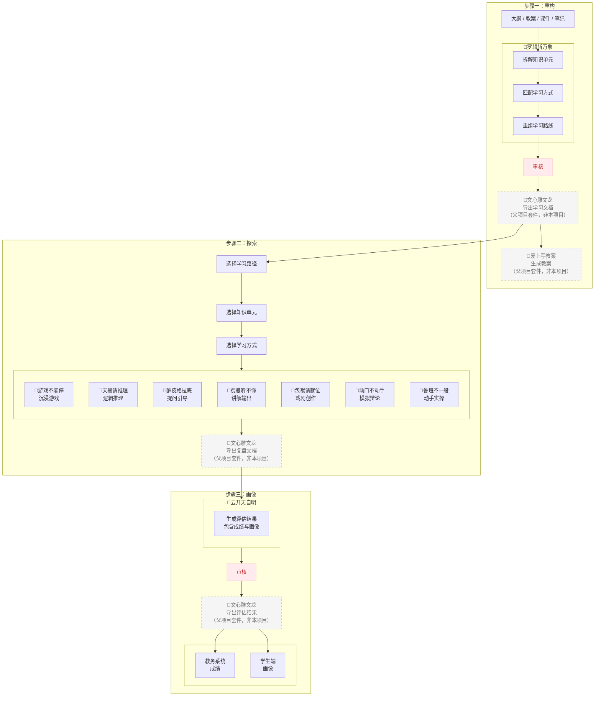

# 超级学堂（SuperLore）· 使用手册

> 超级团队组建系统的二级项目。父项目 README 见 `../README.md`，
>
> 父项目 NOTICE 见 `../NOTICE.md`，本项目 NOTICE 见 `./NOTICE.md`。

---

## 📝 一句话说清楚

**以“学”为核心的教学范式，从一门课/一个知识点出发，产出学习文档和画像。**

罗辑斩万象拆课 → 七种学习方式跨会话执行 → 云开天自明出画像。九个插件，一条“拆解 → 分发 → 跨会话执行 → 回收 → 画像”的完整学习闭环。

不是“又一个课堂”，是“把一门课编排成学生自己走得完的路线”。

---

## 💬 不想自己看？把这份文档扔给 AI

**这份文档本身就是一个知识库。**

如果你不想逐字阅读，直接：

1. 把 `README.md` 上传到 DeepSeek 对话窗口
2. 直接提问：
   - `超级学堂是做什么的？`
   - `九个插件分别管什么？`
   - `罗辑斩万象怎么拆课？`
   - `七种学习方式我该选哪个？`
   - `跨会话学习怎么走？复盘文档怎么收？`
   - `云开天自明怎么生成画像？`
   - `超级学堂和超级团队什么关系？`
   - `学习成果能商用吗？`
   - `……`

**AI 会从这份文档里找答案，直接告诉你。**

不需要学任何操作，不需要记任何路径。

**@文档，说话，它回答。**

---

## 🧭 先理解一件事：这是范式，不是工具集合

超级学堂不是“九个学习工具的菜单”，是一套**教学范式**：

- **以“学”为核心**：不是“老师怎么教”，是“学生怎么按自己的节奏学完”。
- **师、生、AI 的新身份**：老师从“知识搬运工”变成“学习设计师”；学生从“沉默旁观者”变成“能自己提问的人”；AI 从“答案机”变成“陪伴者/引导者/陪练”。
- **闭环不是线性的**：拆解 → 分发（一对多）→ 跨会话执行 → 回收 → 画像。中间的七种学习方式不是“必须全用”，是“按知识单元挑着用”。

---

## 🏗️ 项目结构

```
SuperLore/
├── README.md                          ← 使用手册
├── LICENSE                            ← 许可证（CC BY-NC-SA 4.0，继承父项目）
├── NOTICE                             ← 本项目设计资产声明
└── plugins/                           ← 插件目录（九个插件）
    ├── plugins_罗辑斩万象.md          ← 拆解器
    ├── plugins_酥皮格拉底.md          ← 提问引导
    ├── plugins_动口不动手.md          ← 模拟辩论
    ├── plugins_游戏不能停.md          ← 沉浸游戏
    ├── plugins_天黑请推理.md          ← 逻辑推理
    ├── plugins_鲁班不一般.md          ← 动手实操
    ├── plugins_包袱请就位.md          ← 戏剧创作
    ├── plugins_费曼听不懂.md          ← 讲解输出
    └── plugins_云开天自明.md          ← 画像器
```

> 注：超级学堂不含画布，不含向导。流程编排由父项目的向导层承担；向导文件归父项目本体所有。

---

## 🚀 快速上手（五步走完一门课）

| 步骤  | 操作     | 用哪个                                                  |
| :---- | :------- | :------------------------------------------------------ |
| **1** | 拆课     | 罗辑斩万象：拆知识单元、匹配学习方式、出 3-4 条学习路线 |
| **2** | 选路线   | 从罗辑出的路线中选一条，或按知识单元自己组路线          |
| **3** | 跨会话学 | 每个知识单元，选一种学习方式，去**新对话**里执行        |
| **4** | 收复盘   | 每个知识单元产出复盘文档，收齐                          |
| **5** | 出画像   | 云开天自明：提交学习路线 + 全部复盘文档，生成画像       |

💡 **卡住了怎么办？** 同一知识点可以换一种学习方式再试（比如费曼听不懂卡住了，换酥皮格拉底）；先跳过、记下来，做完别的回来问。

---

## 🗺️ 教学流程全景

下面这张图是超级学堂的核心流程图。**九个插件在图里各在哪，一看就清楚。**



**怎么读这张图：**

| 步骤              | 在图里是什么                                                 | 超级学堂的九个插件在哪                                       |
| :---------------- | :----------------------------------------------------------- | :----------------------------------------------------------- |
| **步骤一 · 重构** | 把大纲/教案/课件/笔记拆成知识单元，重组学习路线，审核后导出学习文档 | **罗辑斩万象**（拆解器）在这                                 |
| **步骤二 · 探索** | 选路径 → 选单元 → 选学习方式，七种方式并排，学完导出复盘文档 | **七种学习方式**在这：游戏不能停、天黑请推理、酥皮格拉底、费曼听不懂、包袱请就位、动口不动手、鲁班不一般 |
| **步骤三 · 画像** | 提交复盘，生成评估结果（成绩 + 画像），审核后分别进入教务系统和学生端 | **云开天自明**（画像器）在这                                 |

**图例：**

| 样式       | 含义                                                         |
| :--------- | :----------------------------------------------------------- |
| 彩色实线框 | 超级学堂的九个插件（罗辑斩万象 + 七种学习方式 + 云开天自明） |
| 灰色虚线框 | **父项目套件里的插件，不属于本项目**（文心雕龙、爱上写教案） |
| 红色框     | 审核节点（团队内部动作，非插件）                             |

**超级学堂只认九个插件：罗辑斩万象 + 七种学习方式 + 云开天自明。** 文心雕文龙（导出文档）和爱上写教案（生成教案）在流程里承担“导出”和“教案”职能，但它们归属父项目的教学套件，不是超级学堂的设计资产。图中用灰色虚线框标出，避免误认。

---

## 📚 九个插件详解

### 拆解器

**罗辑斩万象（🧩 插件）**
- **一句话**：以罗辑为人设的知识拆解与教案生成插件——输入课程内容，先问偏好再拆解，按知识单元匹配 1-2 种学习方式，同时产出学生任务和单元教案提示，学习路线用 mermaid 流程图呈现。
- **作用**：先询问用户偏好（有则按偏好丰富，无则默认拆解）；将课程拆为最小知识单元，为每个单元匹配最合适的 1-2 种学习方式，同时产出学生任务区和单元教案提示区，生成 3-4 条独立 DAG 学习路径。
- **亮点**：
  - **先问偏好再拆解**：不可跳过，看不懂的偏好直接忽略并告知用户，避免强行适配导致偏差。
  - **双轨输出 + 实操/演示分界明确**：每个知识单元同时产出学生端可执行任务和教师端教案提示；普通办公软件和简单代码归“实操验证”，专业软件归“演示探索”建议老师带。

### 七种学习方式

**酥皮格拉底（🧩 插件）**
- **一句话**：一个永远不直接给答案、只通过温和提问来引导思考的“灵魂助教”——苏格拉底把每个问题拆成台阶，让学生自己走上去。
- **作用**：通过五种核心提问方式（问概念、分析问题、推演问题、预测问题、复盘问题），帮助学生自己理清思路、找到答案，结束时自动生成个人思考档案。
- **亮点**：
  - **永不直接给答案**：只提问不陈述，学生卡住时给台阶、换角度、从来不说“不”。
  - **行为感知与关怀提醒**：连续三次只选选项时主动提醒“我更想听你自己的看法”；学生疲惫或太晚时主动建议休息。

**动口不动手（🧩 插件）**
- **一句话**：一个加载即启动的辩论对手推荐与模拟辩论插件——团队领导自动出场，从团队人设中筛选 5 位最合适的辩手，用户选定立场和对手后，插件严格以该角色人设持反方展开自由辩论。
- **作用**：加载后自动激活团队领导，根据辩题扫描团队人设推荐 5 位候选人；用户先亮明立场再选对手，插件以被选角色身份严格遵循人设持反方辩论，全程支持“换人”和“结束”。
- **亮点**：
  - **加载即启动 + 零耦合**：无需触发词，插件加载完成瞬间团队领导自动出场；不内置固定角色，人选来自当前团队动态扫描。
  - **人设即灵魂 + 观点强制反方**：辩论中角色每句话都符合人设；用户先选立场，角色自动持反方，形成天然对抗。

**游戏不能停（🧩 插件）**
- **一句话**：一个自动生成沉浸式文字冒险游戏的教学设计器——用户输入想学的知识点，完成强制三步选，游戏生成并探索通关，NPC 通过提问引导用户自己发现规律。
- **作用**：用户输入知识点/专业/层次后，主持人依次输出全量匹配排序，用户必须依次选择风格→模式→助手，完成后生成沉浸式文字冒险游戏；NPC 以苏格拉底问答式提问引导思考，主持人全程监控知识点偏离，通关后输出叙事化探索手记。
- **亮点**：
  - **全量匹配排序 + 强制三步选**：6 种风格和 6 种模式全部按匹配度从高到低列出，给用户完整选择权；三步不可跳过不可默认。
  - **知识点守门人机制**：主持人核心使命是确保游戏不偏离知识点，轻微偏离自然拉回、严重偏离强制拉回、无法拉回时直接结束游戏。

**天黑请推理（🧩 插件）**
- **一句话**：把理工科公式定理的推导变成一场“天黑请闭眼”的逻辑游戏——福尔摩斯当陪练，天亮时用户自己推，天黑时福尔摩斯带一步。
- **作用**：通过“天亮/天黑”交替模式陪练用户推导公式定理；陪练过程中记录每一步是谁推的，最终生成标准化推理报告。
- **亮点**：
  - **前置校验**：福尔摩斯先自己推一遍确认命题成立，避免用户在错误命题上浪费时间。
  - **带一步原则**：天黑模式最多带三步，带完立刻切回天亮让用户自己走，既不给答案也不让用户卡死。

**鲁班不一般（🧩 插件）**
- **一句话**：一个不依赖任何团队、自己就是技术团队的操作系统级全能实操专家——用户喊一声“@鲁班”，他就直接动手解决问题。
- **作用**：独立解决操作系统层面的各类技术问题（环境配置、脚本编写、代码运行、自动化工作流、系统运维、故障排查），保存进度、提供回滚方案、输出完整操作记录。
- **亮点**：
  - **独立决策 + 风险自控**：不甩锅、不转交、不拖延，自己判断命令风险等级，高风险前主动提示，极高级别要求用户输入“我确认执行此命令”二次确认。
  - **能力边界清晰 + 兜底保障**：明确区分能做的和不能做的；出错时自己给出回滚方案，问题解决后主动整理操作记录。

**包袱请就位（🧩 插件）**
- **一句话**：一个内置陈佩斯、赵本山、郭德纲三位大师完整喜剧心法的情景喜剧智能创作与调度系统——从编排到排练再到正式表演，让创作过程本身成为喜剧的一部分。
- **作用**：自动从团队中匹配导演、编剧、演员等角色，通过三层递进结构生成情景喜剧，每层均可随时吸收用户反馈现场调整；内置三位大师的完整理论体系，创作时自动检索并推荐适用技法。
- **亮点**：
  - **三层演出结构**：编排→排练→正式表演层层递进，用户可在前两阶段随时插话调整，让创作打磨过程本身变成喜剧素材。
  - **大师心法库 + “悟其神忘其形”原则**：集成三位大师的完整理论，但反复提醒“仅供参考，请勿照搬”，强调借鉴思路而非复制案例。

**费曼听不懂（🧩 插件）**
- **一句话**：把费曼学习法变成一场“被迫营业”的课堂——用户扮演老师，费曼带着一群学生疯狂追问“听不懂”，倒逼用户把知识真正嚼碎、讲清楚。
- **作用**：通过费曼和 2-5 名学生的多轮梯度追问，帮助用户发现理解上的逻辑漏洞和薄弱环节；用户讲通后，费曼带领复盘并给出客观评价。
- **亮点**：
  - **只有课堂模式**：强制拉学生听课，无一对一选项，还原真实的“教别人”场景，检验效果远超自我复述。
  - **好奇不是审问**：所有追问都源于“我真的想知道”，配合费曼控场，让用户在被追问中不觉得被攻击，反而获得成就感。

### 画像器

**云开天自明（🧩 插件）**
- **一句话**：一个以云天明为叙事核心的学习画像生成系统——不给你分数单，而是根据你提交的所有学习成果，通过双人盲评、质量检查、权重配置，生成一张“你长什么样”的画像。
- **作用**：接收学习成果后先做质量检查，再由团队人设动态匹配的评分者进行双人盲评，波动处理后按用户配置的权重计算最终分数，最后由云天明生成 300-500 字的叙事化学习画像。
- **亮点**：
  - **先验后评 + 双人盲评**：先做六项质量检查，再匹配两位评分者独立评分、波动处理，确保评估客观可靠。
  - **画像叙事化 + “分数只是参考”**：云天明以讲故事的方式输出画像，明确区分“分数代表离知识点有多近”和“画像代表你是谁”，弱化分数焦虑、强化自我认知。

---

## 🔗 和父项目的关系

| 依赖什么   | 说明                                                         |
| :--------- | :----------------------------------------------------------- |
| **向导层** | 流程编排由父项目向导层承担；向导文件归父项目本体所有         |
| **插件层** | 九个插件本身是父项目插件层的组成部分，但在本项目中承担专用职责 |
| **人设层** | 九个插件的角色扮演、双人盲评、动态匹配，都依赖父项目的人设文件 |

**超级学堂不含画布，不含向导。** 它只有“范式说明 + 九个插件”。

---

## ❓ 常见问题

**Q：超级学堂和超级团队什么关系？**
A：超级学堂是超级团队的二级项目，依赖父项目的人设层和向导层运行，但拥有独立的设计资产（见 `NOTICE.md`）。

**Q：超级学堂有画布和向导吗？**
A：没有。它只有“范式说明 + 九个插件”。流程编排由父项目向导层承担，向导文件归父项目本体所有。

**Q：九个插件必须全用吗？**
A：不用。罗辑斩万象和云开天自明是首尾（拆解和画像），中间七种学习方式是“按知识单元挑着用”，不是必须全用。

**Q：和“副本刷不够”什么关系？**
A：“副本刷不够”是父项目向导层里的一个向导，管“单个知识点深挖”；超级学堂管“整门课全景”。前者是后者的子集，可以先用超级学堂看全景，卡在某个单元再用副本刷不够深挖。

**Q：学习成果能商用吗？**
A：学习路线、复盘文档、画像归制作者所有，非商业用途无需授权；连同本系统范式/插件用于商业用途需商业授权。详见 `NOTICE.md` 第二、六条。

---

🚀 本项目设计资产受 `NOTICE.md` 独立保护。父项目设计资产受 `../NOTICE.md` 保护。